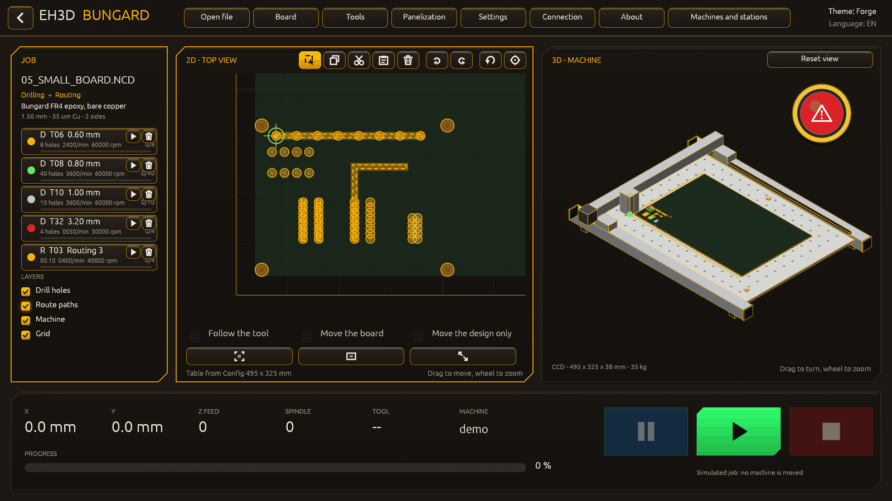
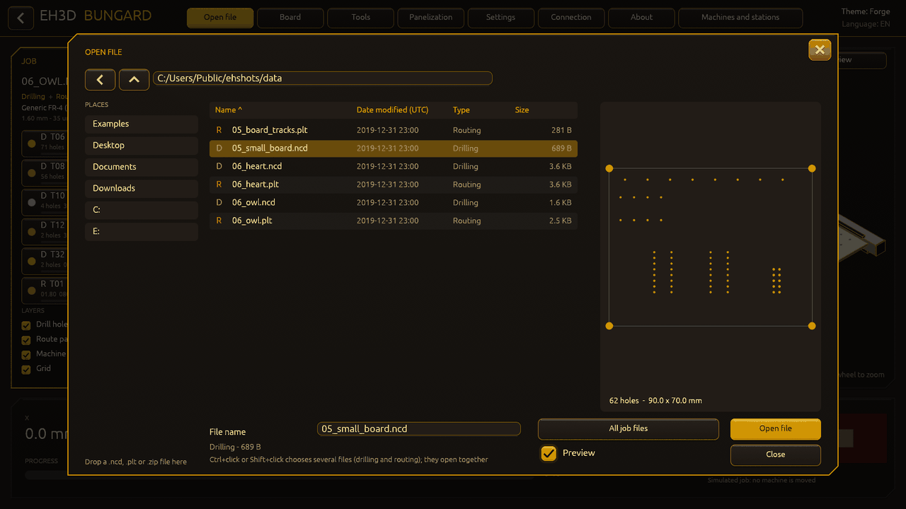
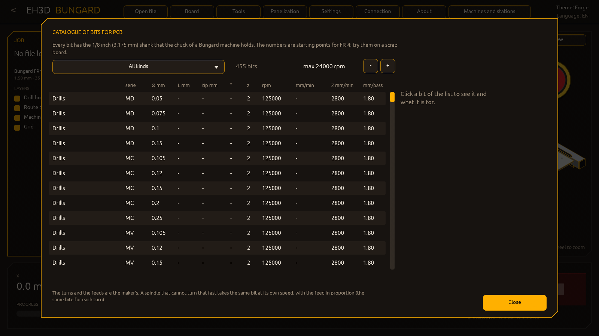

<p align="center">
  
</p>

# 🖥️ EH3D-BUNGARD-GUI

<p align="center">🇺🇸 <b>English</b> | <a href="README_spa.md">🇪🇸 Español</a> | <a href="README_fra.md">🇫🇷 Français</a> | <a href="README_ita.md">🇮🇹 Italiano</a> | <a href="README_deu.md">🇩🇪 Deutsch</a> | <a href="README_zho.md">🇨🇳 中文</a> | <a href="README_jpn.md">🇯🇵 日本語</a> | <a href="README_por.md">🇵🇹 Português</a></p>

### The modern window for the Bungard CCD machines: a launcher, a 2D and a 3D view of the job, drilling and routing together, in 37 languages

<p align="center">
  
  
  
  
  
  
</p>

---

**Honesty check - what actually runs today:** a Rust program with a window and 198 tests that run on a computer. The launcher offers the modern interface or the classic drilling and routing programs for a machine with manual (MTC) or automatic (ATC) tool change. The viewer opens drilling files, HP-GL plot files and ZIP archives of jobs (from a folder browser, by drag and drop or from the command line), draws the plan view with every hole by drill size and the routing paths over it, shows the machine in 3D with the table of the size chosen in the configuration, panelizes the board and follows the job as it runs. The job runs on the **simulator** of the engines of EH3D-DRILLPRO and EH3D-ROUTEPRO; the same machine file they read decides how a real machine is reached (the computer's RS-232, a USB-RS232 adapter, or the EH3D-NODE-BUNGARD directly or through EH3D-SERVER), and **none of those has been tried from this window**. The windows of the connection, the settings and the tools change the values they offer, the whole machine and tool files cannot be edited yet, and the 3D view does not show the height of the tool paths.

---

> **Safety and security status:** this program is not a safety system. It does not handle limit switches or an emergency stop, and it has never driven a real machine. With a real connection in the machine file the job would move the machine through the engines of EH3D-DRILLPRO and EH3D-ROUTEPRO: read their notes first, take the tool out, keep a hand on the machine's power switch and be ready to stop the job. The project is independent: it is not made, endorsed or supported by Bungard Elektronik, and product names appear only to say which file formats and machines it is meant to work with.

## 📋 At a glance

| | |
|---|---|
| Version | `0.1.8` |
| Maturity | Scaffolding |
| Tests | 198 |
| Stack | Rust |
| On real hardware | No. It has run on the simulator and on a computer only; no machine has been driven from this window |

**Jump to:** [Overview](#-overview) · [Architecture](#-architecture) · [Quick start](#-quick-start) · [Testing](#-testing) · [Structure](#-repository-structure) · [Related](#-related-projects)

## 🚦 Project status

Each line is one part of this repository and the light says how far it is today. It is written from what the repository can show (tests, builds, runs), not from what is planned.

🟢 Done and verified · 🟡 Works, with known limits · 🟠 Partly done or not verified yet · 🔴 Not done or not working

| Area | State | What it means here |
|---|---|---|
| Window and launcher | 🟡 | A Rust window with a launcher (the modern interface or the classic programs), five themes and 37 languages; it runs on a computer and has been looked at with pictures of the simulated job. |
| Views | 🟡 | The plan view (holes by drill size, routing paths) and the 3D view of the machine with rails, perforated table, moving gantry and tool rack, fitted to the table size; both are dragged and zoomed. The 3D view shows no height of the tool paths yet. |
| Files and panelization | 🟡 | Drilling files, HP-GL files and ZIP archives are opened from a browser, by drag and drop or from the command line; the board is repeated in three modes. Tried with the small sample files of this repository. |
| Settings | 🟠 | The usable width and depth of the table are changed and saved to the machine files; the rest of the machine and tool files is still edited with the classic programs. |
| Machine control | 🔴 | The job goes through the engines of EH3D-DRILLPRO and EH3D-ROUTEPRO, so every connection they have is there in principle; it has run on the simulator only. The Connection window chooses the link (the computer's RS-232, a USB-RS232 adapter, the EH3D node or the EH3D server), tests it and saves it to the machine file, and Pause holds the job between two moves. |
| Tests | 🟡 | 198 tests pass on a computer (`cargo test --features gui`): the launcher, the settings, the reading of the files into the scene, the machine profiles, the panel and the command line. None of them touches a machine. |
| Ready-made packages | 🟠 | A workflow builds the program for Windows (64 and 32 bits), Linux and macOS with the sample files; no release has been published yet. |

## 🎯 Overview

* The **launcher**: the modern interface, or the classic drilling and routing programs for a machine with manual or automatic tool change; they are started as the programs they are when they are next to this one. The choice can be remembered.
* The **plan view**: the table with every hole by drill size and the routing paths over it, dragged with the mouse and zoomed with the wheel; a button (or a double click) puts the view back.
* The **3D view of the machine**: rails, perforated table, moving gantry and tool rack, with the table of the size set in the configuration. It is turned with a drag, zoomed with the wheel and moved with Shift or the right button. The machine profiles (CCD/2, CCD, CCD Premium and CCD XL) come from the published sizes; the machine is told by the table of the configuration.
* **Opening files**: a drilling file, an HP-GL file or a ZIP archive with a job inside, from an Open window with a folder browser and the drives, by dropping the files on the window, with `Ctrl+O`, or given on the command line. A name in an archive that would leave the work folder is not listed, and no file is read past a size limit.
* **Panelization**: copies of the board in columns and rows, placed by the gap between boards, by the distance from one to the next, or as many as fit in the table; the copies are drawn and the job makes them.
* The **job**: it runs on the engines of the classic programs with their machine file (`demo` simulator, `rs232`, `usb`, `node` or `server`), shows the progress as it goes and puts the questions of the machine to the operator (the spindle, the tool change).
* The **board and the tools**: a library of base materials of many makers (Bungard, Fortex, CIF, generic FR-4, CEM and FR-2, Isola, Panasonic, Shengyi, ITEQ, Ventec, Nelco, Arlon, Rogers, Taconic, Bergquist, DuPont, MG Chemicals, MSC, Yuxinda, ThinFlex) chosen by material, thickness, copper, copper sides and size, and remembered; the tools of the job are listed as drilling or routing with their feed and speed, the one that works is lit, and every value has default values (from the diameter of the drill and the material of the board) or can be clicked and typed.
* **Sheets without copper to mill and drill:** besides the copper-clad boards, the library has plain sheets in their usual thicknesses (aluminium alloy 0.2 to 5 mm, copper 0.1 to 5 mm, PTFE 0.2 to 5 mm, birch plywood, MDF, balsa and basswood 0.5 to 5 mm, acrylic, polycarbonate, ABS, POM, nylon, PVC, HDPE, PETG, G10 and phenolic paper). They carry no copper (the Board window says so and hides the copper sides) and no electrical figures that nobody publishes for them, and each kind of material has its own starting speed, feed and depth per pass for drilling and routing, always inside the limits of the spindle.
* The **settings**: the theme, the language, the usable size of the table, the speed of the simulation (a job takes the time of the machine, from x0.5 to x50), whether the job asks at the tool changes and when the spindle starts, and whether this window opens directly the next time. The buttons light up under the pointer and sink when they are pressed.
* **Tabs for the outside of a panel:** in the Panelization window the outside can be routed with tabs that hold the boards until they are broken out: how many on each side, how wide, and where (spread evenly, near the ends or together in the middle); the plan view shows the cut paths. The maker, the thickness and the size of the board are chosen from drop-down lists too.
* **The table is calibrated:** a tab of the Settings window measures the height of the table in a grid of points (7 by 5 by default), draws the map (blue low, red high) with the spread and the tilt in mm per metre, and keeps it with the machine. Until the probe node is connected the probe is simulated, and the correction of the jobs is not applied yet.
* **The job goes on after a crash:** while a job runs, what it needs to go on (the file, the panel, the holes drilled) is saved in real time; if the window, the computer or the link goes down, the next start asks whether to go on from where it was or to cancel it. The window opens maximized and the job buttons are bright (green to start, blue to pause, red to stop).
* **Spoken notices:** besides the tones, the end of the job and the request for a tool can be said by a voice, in the language and the gender chosen from the same list of sounds (`sound_finish = voice:es:f`). The voices in the folder `voices/` are synthetic (Piper) and free to give away, with a slow and formal sentence; there are voices for 27 languages (the first seven and Bulgarian, Czech, Danish, Dutch, Estonian, Finnish, Greek, Hungarian, Latvian, Norwegian, Polish, Romanian, Slovak, Slovenian, Swedish, Ukrainian, Russian, Albanian, Basque and Brazilian Portuguese; the gender of the new ones was not heard, so check it), the others (Japanese, Croatian, Irish, Maltese, Catalan, Galician, Serbian, Icelandic and Lithuanian) have no voice that is free to give away and play the tone, there is no female Chinese or Portuguese voice and no real recording of a person: put your own WAV files in the same folders and they replace them. See `voices/README.txt`.
* **A catalogue of bits:** a window (from the Tools window) lists more than 450 bits with the 1/8 inch (3.175 mm) shank of the chuck of a Bungard machine, in twelve kinds: the drills from the 0.05 mm micro series to 7 mm (small, medium range and large ones with a chip breaker), slot drills, diamond-cut, down-cut, up-cut, chip-breaker and diamond-coated routers, end mills, V-bits, ball noses, spot drills and countersinks. Each one has its series, the length of its flute and the turns, feeds and depth of a pass of the maker's table for FR-4; a click draws the bit (with its measures) and says what it is for, and a spindle that turns slower than the table (24 000 turns by default, changed in the window) gets the same bit with its feeds lowered in proportion. A V-bit tells how wide its groove is at a depth. The sample board has the isolation of four tracks, cut with a V-bit (tool 3 of the routing table).
* **The jobs follow the table, and the node of the drill head:** a check box of the calibration tab makes drilling and routing correct their Z with the map of the table (only a complete map, only when asked for); a window (from the Connection window) sets how EH3D-NODE-BUNGARD-AUX is reached (not used, directly or through the server), its address and token and whether its camera is shown, and shows the picture of the camera, the speed and the temperature of the spindle, the protect output and a measure of the table under the head. Through the server it asks the node by the server, with the address, the token and the machine id of the connection window (the server holds the token of the node); the probe of the calibration is still simulated.
* **Easier to read and to move:** the list of tools of the job card scrolls instead of pushing the layers out of the window, every open drop-down list has a bar that works (drag, click, wheel), a button of the 2D view moves only the design over the board and the table, each routing tool has its own colour in the 2D and 3D views (a file with three mills shows three colours), and the tabs are cut into the outside of a board even when there is a single copy, and only into the outside, never into the pockets and tracks inside.
* **Quiet animations:** screens and windows fade in as they open, and while a job runs the ring of the head breathes and sends out a ripple, the dashes of the paths still to cut move along them, a light crosses the progress bar and the working tool breathes in the list. At rest nothing moves.

## 🧩 Role in EH3D

EH3D-BUNGARD-GUI is the modern interface of the Bungard machines in the EH3D family. It depends by path on the sibling folders EH3D-COMMON (the scene, the themes and the texts in 37 languages of `eh3d-view`, and the ZIP reader of `eh3d-archive`), EH3D-DRILLPRO and EH3D-ROUTEPRO (their engines and their classic programs): they must sit next to this one.

## 🏛️ Architecture

<p align="center">
  
</p>

How the parts of this repository fit together: who uses it, what it holds and what it depends on. The picture is drawn from `docs/architecture.json` and checked against the code.

## 🖼️ Screenshots

<p align="center">
  
</p>

<p align="center"><em>The viewer: the job on the table in 2D, the machine in 3D and the controls of the job.</em></p>

<p align="center">
  
</p>

<p align="center"><em>Editing in the 2D view: the choosing tool has taken the holes of the left part of the board, ready to copy, paste, cut or delete; every tool of the list has its own button to take it out of the job.</em></p>

<p align="center">
  
</p>

<p align="center"><em>The Open window with the preview of the drilling file chosen, at the right of the list; a switch below turns it off and the list takes its room back.</em></p>

<p align="center">
  
</p>

<p align="center"><em>A job running: the holes and paths that are done, the position of the tool, and Pause and Stop.</em></p>

<p align="center">
  
</p>

<p align="center"><em>The Neon Arcade theme with the board panelized.</em></p>

<p align="center">
  
</p>

<p align="center"><em>The tools: feeds, speeds and depths, the holes of each drill on the board and the holes drilled in all.</em></p>

<p align="center">
  
</p>

<p align="center"><em>The settings: every Bungard model, the table and the units of the files.</em></p>

<p align="center">
  
</p>

<p align="center"><em>The board: a material from the library, its thickness, its copper and its size.</em></p>

<p align="center">
  
</p>

<p align="center"><em>The catalogue of bits, filtered by kind, with the warnings for the spindle and the material of the board.</em></p>

<p align="center">
  
</p>

<p align="center"><em>Eleven themes in the settings window, each one named in the language of the window.</em></p>

<p align="center">
  
</p>

<p align="center"><em>The list of sounds of the end of the job: sixty sounds from the high ones to the low ones, the standard tone, none or a file of your own.</em></p>

<p align="center">
  
</p>

<p align="center"><em>The Panelization window: the copies of the board and the tabs of the outside, chosen with drop-down lists and steppers.</em></p>

<p align="center">
  
</p>

<p align="center"><em>The calibration of the table: the map of heights measured in a grid of points, with the spread and the tilt.</em></p>

<p align="center">
  
</p>

<p align="center"><em>The Paper theme, a light one.</em></p>

<p align="center">
  
</p>

<p align="center"><em>The machines and stations of the server: state, job and progress of each machine, and the machine the jobs go to.</em></p>

<p align="center">
  
</p>

<p align="center"><em>The node of the drill head: its camera, the speed and the temperature of the spindle, the protect output and the ring of LEDs around the camera (off and three levels).</em></p>
<p align="center">
  
</p>

<p align="center"><em>The quality check after the job: the camera looks at the board, every hole of the job is marked (green right, red wrong, amber out of view), the milled channels are measured and the verdict is as big as a sign.</em></p>
<p align="center">
  
</p>

<p align="center"><em>The tolerances of the analyser of the shop: hole size and position, roundness, debris, width and evenness of the channels, and what makes a picture good enough to judge.</em></p>

## ✨ Features

* Themes: Forge (the default), Neon Arcade, Glass Pro, the classic Windows grey and one that follows the colours of Windows.
* 37 languages in the whole window: English, Spanish, French, Italian, German, Chinese, Japanese and European Portuguese.
* Text boxes have the menu of the right button (Cut, Copy, Paste, Select all, Undo) and take the usual keys; the width of the list of the job, of the plan view and of the machine view is adjusted by dragging the thin bars between them (a double click gives the default back); the window can fill the screen (F11 or Settings); a board that does not fit the table of the active machine, even turned 90 degrees, is warned about; and the list of boards is in alphabetical order and also shows the boards of all the makers at once.
* Machine profiles with the published sizes and an adjustable table: the machine in 3D grows with the usable area of the configuration.
* A window of the machines and stations: with the server connection it shows every machine of the server grouped by station, what each one is doing, its job with the progress, the jobs ready, and chooses the machine the jobs of the window go to; `--fleet FILE.json` shows a saved answer without a server.
* Choosing a machine model in the settings fits both views to its table: the 2D plan, the 3D machine (frame, rails, gantry and tool rack of that model) and the zoom start again for the new measures.
* Jobs in ZIP archives: the first drilling file and the first routing file are shown, the others are listed to be loaded with a click.
* Panelization in three modes (gap, pitch, as many as fit) with the copies drawn on the table.
* Live progress of the job and the questions of the machine to the operator.
* An About window with the version, the licence and the connection in use.
* Settings in tabs with every Bungard MTC and ATC model (table, tool changer, limits) and the units of the steps and coordinates (mm or mil), all with a real effect on the job.
* An emergency button that can be shown, hidden and dragged; Start goes out while the job runs and comes back with Pause or Stop; the simulation goes on in the background.
* A 2D view that follows each tool, turns the drilling and routing files together and moves the board; a library of more than a hundred base materials; sounds at the end of the job and at a tool change.
* Files of other programs: the outline of a Gerber board (`.GKO`, `.GM1`, `.GML` or a `.GBR` that calls itself the profile) and a DXF drawing open as routing jobs; the circles and arcs of plotter files (`CI`, `AA`, `AR`) are cut into chords by the chord angle of the configuration.
* A job that does not fit on the table is refused before it starts; the Open window lists the last files opened; the tools window counts the holes of each drill on the board and in all the jobs, with a button that starts the counts again.
* The window of the tools opens over a file you open (from the Open window, the recent files or by dropping it), as the classic programs show the tools of a file after loading it; a check box in the settings turns it off.
* Drop-down lists where a choice has many values: the theme, the language, the model of the machine and the sound of each event are chosen from a list that scrolls, instead of rows of buttons. The end of the job and the request for a tool each have their own list of 60 sounds, from the high ones to the low ones (chimes, rising and falling notes, fanfares, beeps, alarms, knocks, sirens), the standard tone, none, or a file of your own; choosing one plays it.
* **Light and quality check with the camera of the head:** the window of the node turns the ring of LEDs on and off, and the Quality check window looks at the board after the job: it judges the holes of the job (there, round, the right size, in place), the milled channels (as wide as the tool, even, no pinches) and the picture itself, marks every hole on the picture, shows a verdict as big as a sign (OK, NOT OK or cannot judge) and makes the ring say the same in colour. Presets of the profile (standard, fine pitch, prototype), tolerances, the scale and its calibration from a known hole are kept in a file and given to the server. The result can be said aloud: two more sounds in the settings, for a check that is correct and one that is not, each off, a beep, a sound of the catalogue, a file of yours or a voice that says that the visual check of the board is correct or is not correct, like the other sounds.
* **A machine in 3D that behaves like the real one:** at rest the head waits at home, and moving the board in the plan view never moves it. When a job starts the machine powers up, goes home, travels to the first point of the work and only then does the work begin, with the head following it, for drilling and for routing; at the end it goes home again. The bars of the lists have their arrows up and down.
* **Two spindles and a catalogue that knows them:** the machine carries the original spindle (63000 rpm) or the one with its variable-frequency drive (24000 rpm), chosen in the settings, each with its own limits (turns, XY and Z feeds, thickest bit) that are kept in the settings file. In the tools window each tool has a Catalogue button: pick a bit and its speeds, feeds and passes go to the tool. If the spindle cannot give them the window says so: the values it can use are suggested (the same bite for each turn, slower XY or Z), or the bit is marked as not compatible and cannot be taken. The lists of boards show 16 materials at once.
* **Drilling, routing or both, tool by tool:** the drilling and the routing of the job are switched on or off in the left panel and in the tools window (both on: the drilling and then the routing, one after the other, without the machine going home in between), and the dot of each tool switches that tool off so the job leaves it out.
* **Several files at once, and professional examples:** the Open window chooses two or more files with Ctrl+click or Shift+click (drilling and routing together; several of the same kind make one job, with the tools numbered by their diameter). The `examples` folder of the package has four designs of real complexity, each with its drilling and routing files: a 32-bit microcontroller board (headers, USB notch, LQFP via ring), a four-channel analog front end (DIP amplifiers, BNC and screw terminals, guard rings, an isolation slot), a 2.4 GHz amplifier and filter (edge-launch SMA, via fences, shield-can stitching, isolation milling along the 50 ohm line) and a 5 V 3 A power supply (TO-220, electrolytics, thermal vias).
* **37 languages:** the whole window speaks English, Spanish, Italian, German, French, Portuguese, Chinese, Japanese, Bulgarian, Croatian, Czech, Danish, Dutch, Estonian, Finnish, Greek, Hungarian, Irish, Latvian, Lithuanian, Maltese, Polish, Romanian, Slovak, Slovenian, Swedish, Norwegian, Icelandic, Ukrainian, Russian, Serbian, Albanian, Catalan, Galician, Basque, Brazilian Portuguese and Canadian French. The words of the 29 languages beyond the first eight are translated by the model and wait for a review by native speakers; a text that a language does not have is shown in English. The web panels of the nodes of the machine speak the 37 as well; the screen of the machine (HMI) keeps the first eight for now.
* **Windows without the black window:** the programs with a window (this one, DRILLPRO, ROUTEPRO and MOTIONCNC) open no console on Windows; run from a terminal they still print their help and their errors there. **Windows that move:** every window over the main one is dragged by its top and has an X in its upper right corner.
* **Preview in the Open window:** a plan of the drilling or routing file chosen is drawn at the right of the list, before opening it (holes with their diameter, paths, size of the board). A switch below turns it on or off and the list takes the room that the plan leaves; the choice is kept.
* **Editing the job in the plan view:** a tool of the list at the left can be taken out of the job (its holes or paths go from the file and from every view); in the plan view the choosing tool takes holes and paths with a click or a box (left to right: what is wholly inside; right to left: whatever the box touches; Ctrl or Shift adds), and they can be copied, pasted a few millimetres further on, cut and deleted, with the buttons or with Ctrl+C, Ctrl+X, Ctrl+V, Ctrl+A and Delete. The files written by an edit are new ones; the original is never changed.
* **Relief and icons everywhere:** buttons, check boxes, text boxes, list bars (with their little arrow buttons) and the boxes of the lists have a gradient, an edge of light and a shade, and answer to the pointer with a glow and by sinking when pressed, in every theme; the X of the corner of a window is red, turns and glows under the pointer; the small buttons of the plan view and of the Open window are icons with a note that says their name.
* **More editing in the plan view, start at a tool and serial ports:** what is chosen can be dragged (or moved with the arrows: 1 mm, 0.1 mm with Shift, 10 mm with Ctrl), cut, and every edit can be undone and redone; on a panel, a hole of any copy is the same hole of the board. Each tool of the list has a button to start the job at that tool (the ones before it are left out) and shows how many holes or paths are done of the total. After panelizing, both views go back to the middle of the work. The Connection window lists the serial ports of the system for RS-232 and USB-RS232 and takes the first one by itself.
* **Launcher, panels and layers in relief:** the cards of the launcher and the panels have a gradient, a shadow and a glow under the pointer, the list of tools of the job and the check boxes of the layers answer to the pointer too, and the "<" that goes back to the launcher is now a button with its note.
* **The tool changer of the ATC models:** before a job starts, a window shows the slots of the rack (slot 0 is the test tool, in the spindle, and stays free) and what goes in each, in the order the job uses the tools; a job with more tools than the rack holds is done in loads: the tools that fit, a stop to load the rack again, and the rest. The tools of drilling and routing share a load while they fit.
* **The tool bar of the ATC models:** the bar at the end of the machine where the tools wait is drawn in the plan view and in the 3D view: its places in a line with their numbers, the tools in them (the colour of their size and their number), the tool in the head, the one to take next and the free place where the used one is left. A button in the Settings window opens a window where the exact position (X, Y, Z) of the first and the last tool and the number of places are set; the places between them are spaced evenly and are saved in the machine file with the other places of the changer, next to the lengths of the tools (38 mm, 21 mm from the ring to the tip), the height the chuck travels at over the tools and the side it comes in from. **None of this has been tried on a real machine.**
* **Bungard catalogue in the board library:** the four Bungard materials carry the data of the 2024/25 catalogue (thicknesses 0.5 to 2.5 mm, copper 18, 35 and 70 um and 105 um at 1.5 mm, the standard cuttings and the panels of 510 x 570 and 510 x 1150 mm; FR2, FR3 and CEM-1 panels). The arrows of the catalogue of the spindle, of the quality check and of the materials, and the boxes of the numbers, have icons and relief too.

## 🔌 Interfaces

* **Window:** the launcher and the viewer, with the mouse and the keyboard (`Enter` accepts the choice of the launcher, `Esc` goes back, `Ctrl+O` opens files).
* **Command line:** `bungard-gui [FILE...] [--drill FILE.NCD] [--route FILE.PLT] [--zip JOB.ZIP] [--lang CODE] [--theme NAME] [--data DIR] [--connection FILE] [--screen launcher|viewer]`; files without an option are opened as what their extension says. `--modal`, `--panel`, `--yaw`, `--shot` and `--start` set a window, the panel, the turn of the 3D view, a picture of the window and the start of the job, for the pictures.
* **Machine:** through the engines of EH3D-DRILLPRO and EH3D-ROUTEPRO and the machine file they share: the computer's RS-232, a USB-RS232 adapter, the EH3D-NODE-BUNGARD, or EH3D-SERVER. Without a machine file the job runs on the simulator.

## ⚙️ Configuration

The connection is the **machine file** of EH3D-DRILLPRO and EH3D-ROUTEPRO (`machine.cfg`, with `connection = demo|rs232|usb|node|server` and every value tuned on a real machine): `--connection FILE` points to it, and without one the job runs on the simulator. `--data DIR` is the folder with the machine and tool files of the classic programs (`DRILLPRO.DCF`, `DRILLPRO.DTD`, `ROUTEPRO.RCF`, `ROUTEPRO.RTD`; the folder `testdata/` has samples). The settings window changes the usable width and depth of the table and saves them to those files. What the window remembers (the launcher choice, the language and the theme) is kept in a small file in the settings folder of the user, with the other EH3D programs. `--theme forge|neon|glass|windows-classic|system` and `--lang en|es|it|de|fr|pt|zh|ja` choose the look and the language.

## 🚀 Quick start

```bash
cargo build --release --features gui
cargo test --features gui
cargo clippy --all-targets --features gui -- -D warnings
cargo fmt --all --check
python -I tools/ci_validate.py
```

Run it with `run.bat` (Windows) or `./run.sh` (Linux and macOS); both build the window first if needed and, without arguments, open the launcher with the test board of `testdata/`. They need Rust and the sibling folders `EH3D-COMMON`, `EH3D-DRILLPRO` and `EH3D-ROUTEPRO`. `cargo run --release --features gui -- --zip JOB.ZIP` opens a job packed in a ZIP archive. On Linux the window needs X11 or Wayland.

## 🧪 Testing

The suite has 198 tests (`cargo test --features gui`). They check the launcher and what it remembers, the settings, how a drilling or an HP-GL file becomes the scene, the machine profiles, the panel and the command line. The engines it uses (protocol, motion, safety gate) are tested in EH3D-DRILLPRO and EH3D-ROUTEPRO. The CI also runs `cargo fmt --check` and `cargo clippy` with warnings as errors, and `python -I tools/ci_validate.py` checks the manifest, the versions, the changelog and the eight READMEs.

## 🏗️ Build & Release

The version lives in `Cargo.toml` and in `eh3d.project.json`, and each version has its entry in [CHANGELOG.md](CHANGELOG.md). `build.bat` / `build.sh` build the window (`cargo build --release --features gui`) and `test.bat` / `test.sh` run the tests; neither changes the version.

**Ready-made packages:** the `Release binaries` workflow of this repository builds the program for Windows (64 and 32 bits), Linux and macOS (Apple silicon and Intel), each package with the licence, this README and the test files as examples, and its SHA-256. No release has been published yet.

## 📂 Repository Structure

<p align="center">
  
</p>

<details>
<summary>Text version of the tree</summary>

```text
EH3D-BUNGARD-GUI/
├── src/
│   ├── gui.rs                                   the window: launcher, plan view, 3D view, job progress
│   ├── gui/extra.rs                             open files, panelization, table settings, About, moving the views
│   ├── gui/fleet.rs                             window of the machines and stations of the server
│   ├── inspection.rs gui/inspect.rs             the quality check of the work through the camera
│   ├── gui/machine3d.rs                         the machine of the 3D view: start, home, first point, work
│   ├── gui/opener.rs  gui/board.rs              Open, board, tools and settings windows
│   ├── jobs.rs                                  a drilling or HP-GL file turned into the scene the views draw
│   ├── boards.rs                                the library of base materials of many makers
│   ├── machines.rs                              the Bungard machine profiles and the work area from the table size
│   ├── launcher.rs                              the launcher choices, the classic programs and what is remembered
│   ├── link.rs                                  the connection of the machine file: which keys it writes
│   ├── cli.rs                                   the command line
│   ├── lib.rs bin/                              the library root and the bungard-gui executable
│   └── spindle.rs                               the two spindles, their limits and whether a bit fits each
├── tests/                                       the tests that look at the files of the repository
├── testdata/                                    a small board: drilling and outline files, and the sample machine and tool files
├── docs/                                        the sources of the two pictures
├── tools/                                       CI check, README check and the picture tools
├── images/                                      banner, the two pictures and the screenshots
├── voices/                                      spoken notices
├── .github/                                     CI and release workflows, issue and pull-request templates
├── build.sh build.bat                           build the window
├── run.sh run.bat                               start the window with the test files
├── eh3d.project.json bump_manifest_version.py   manifest and version utility
├── Cargo.toml Cargo.lock                        the Rust package and its locked dependencies
├── CHANGELOG.md                                 what changed in each version
├── SECURITY.md SUPPORT.md                       how to report a vulnerability and where to ask
└── CONTRIBUTING.md CODE_OF_CONDUCT.md LICENSE   how to contribute, the code of conduct and the licence
```

</details>

## 🗺️ Roadmap & Known limits

**Known limits today**

* No job has been driven from this window on a real machine: it has run on the simulator of the engines of EH3D-DRILLPRO and EH3D-ROUTEPRO only.
* The Connection window writes only the keys of the link into the machine file; the settings window writes the keys it offers (the table, the model, the units, the sounds and the speed of the simulation) and the tools window the feeds, the speeds and the depths; the rest of the machine and tool files is not edited here.
* The pause holds the job between two moves, not in the middle of one, and the 3D view does not show the height of the tool paths.
* Only the CCD and CCD/2 machines are driven; the profiles of the CCD Premium and the CCD XL are drawn, but their own control unit is not supported.
* The window needs the sibling folders EH3D-COMMON, EH3D-DRILLPRO and EH3D-ROUTEPRO next to it, because it depends on them by path.

**Next**

* A pause in the middle of a move, not only between two moves.
* The height (Z) of the tool paths in the 3D view.
* Loading and saving the whole configuration, not only the table size.
* Packaging with the classic programs, so one download has everything.
* A test on a real machine.

## 🌍 Languages

README and texts exist in English, Spanish, French, Italian, German, Chinese, Japanese and European Portuguese.

## 🔗 Related Projects

* [EH3D-DRILLPRO](https://github.com/JuanenRac/EH3D-DRILLPRO): the drilling program; its engine and its classic program are used by this window
* [EH3D-ROUTEPRO](https://github.com/JuanenRac/EH3D-ROUTEPRO): the routing program; its engine and its classic program are used by this window
* [EH3D-COMMON](https://github.com/JuanenRac/EH3D-COMMON): the view (scene, themes, texts in 37 languages) and the ZIP reader that this window uses
* [EH3D-NODE-BUNGARD](https://github.com/JuanenRac/EH3D-NODE-BUNGARD): an ESP32-S3 node that sits in the machine's box and sends the steps out of its own serial port
* [EH3D-SERVER](https://github.com/JuanenRac/EH3D-SERVER): the center of the EH3D family: it can run the job on the machine through its node

## 📚 Documentation

* [Connection and tuning](https://github.com/JuanenRac/EH3D-DRILLPRO/blob/main/docs/CONNECTION.md): the machine file, the connections and every value (EH3D-DRILLPRO)
* [Protocol notes](https://github.com/JuanenRac/EH3D-DRILLPRO/blob/main/docs/PROTOCOL.md): what is known about how the control unit is driven (EH3D-DRILLPRO)
* [Changelog](CHANGELOG.md)

## 🤝 Contributing & Community

* Before a pull request run `cargo fmt --all --check`, `cargo clippy --all-targets --features gui -- -D warnings`, `cargo test --features gui` and `python -I tools/ci_validate.py`: all must pass. See [CONTRIBUTING.md](CONTRIBUTING.md) and the [code of conduct](CODE_OF_CONDUCT.md).
* The README exists in eight languages: a change to the text is made in all eight files, and the two pictures are drawn from `docs/architecture.json` and `docs/structure.json` by `tools/make_architecture.py` and `tools/make_structure.py`.
* Do not describe as working on a machine what has only been tried on the simulator.
* Report a vulnerability privately: [SECURITY.md](SECURITY.md). Questions, ideas and reports: electrohobby3d@gmail.com ([SUPPORT.md](SUPPORT.md)).

## 👤 AUTHOR

**JuanenRac (Electro Hobby 3D)** · electrohobby3d@gmail.com

## 📜 LICENSE

Software: GPL-3.0-or-later. See [LICENSE](LICENSE). Hardware designs of the suite use CERN OHL-S.
