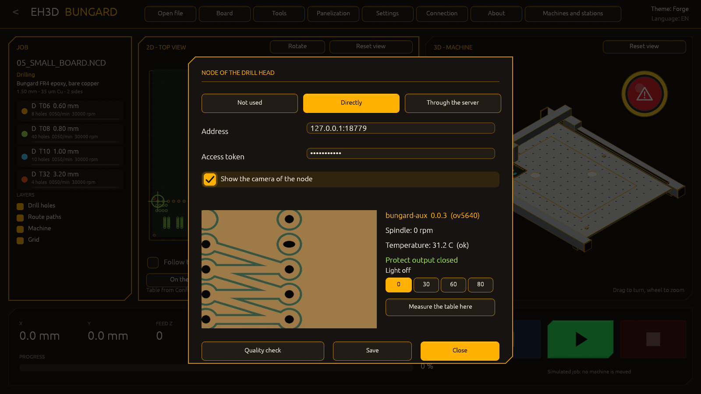
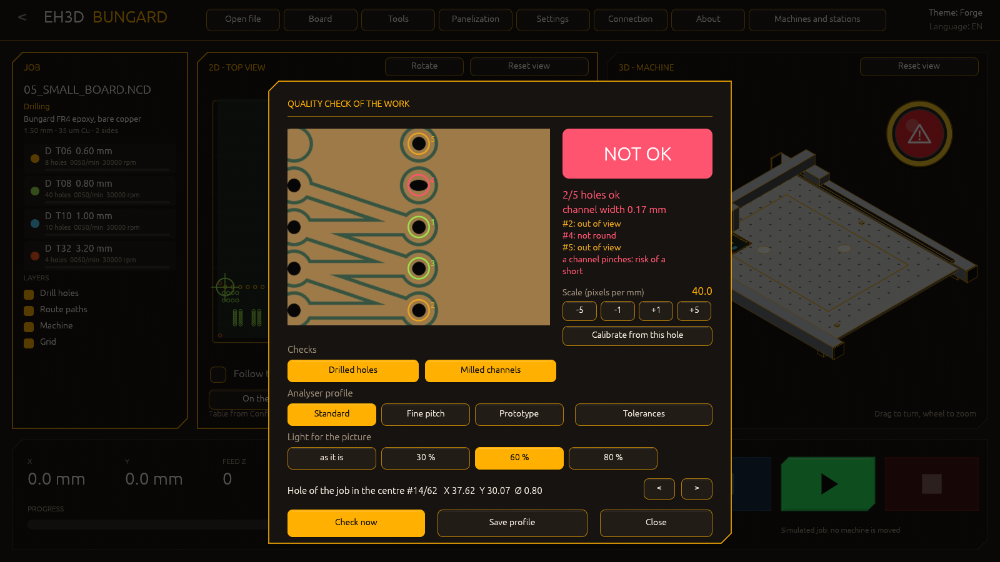
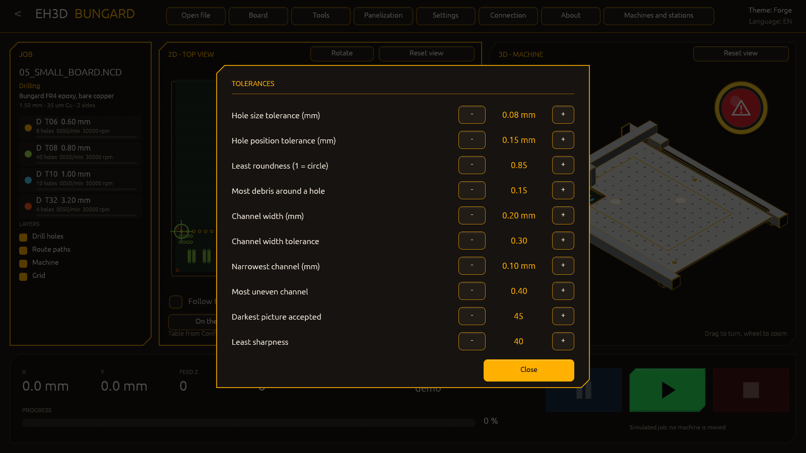

<p align="center">
  
</p>

# 🖥️ EH3D-BUNGARD-GUI

<p align="center"><a href="README.md">🇺🇸 English</a> | <a href="README_spa.md">🇪🇸 Español</a> | <a href="README_fra.md">🇫🇷 Français</a> | 🇮🇹 <b>Italiano</b> | <a href="README_deu.md">🇩🇪 Deutsch</a> | <a href="README_zho.md">🇨🇳 中文</a> | <a href="README_jpn.md">🇯🇵 日本語</a> | <a href="README_por.md">🇵🇹 Português</a></p>

### La finestra moderna per le macchine Bungard CCD: un avviatore, una vista 2D e una 3D del lavoro, foratura e fresatura insieme, in 37 lingue

<p align="center">
  
  
  
  
  
  
</p>

---

**Verifica di onestà - cosa funziona oggi:** un programma Rust con una finestra e 132 test che girano su un computer. L'avviatore offre l'interfaccia moderna o i programmi classici di foratura e fresatura per una macchina con cambio utensile manuale (MTC) o automatico (ATC). Il visualizzatore apre file di foratura, file di tracciato HP-GL e archivi ZIP di lavori (da un browser di cartelle, con trascinamento o dalla riga di comando), disegna la vista in pianta con ogni foro per diametro di punta e i percorsi di fresatura sopra, mostra la macchina in 3D con il piano della misura scelta nella configurazione, pannellizza la scheda e segue il lavoro mentre procede. Il lavoro gira nel **simulatore** dei motori di EH3D-DRILLPRO e EH3D-ROUTEPRO; lo stesso file di macchina che essi leggono decide come si raggiunge una macchina reale (l'RS-232 del computer, un adattatore USB-RS232, o l'EH3D-NODE-BUNGARD direttamente o tramite EH3D-SERVER), e **nessuna di queste vie è stata provata da questa finestra**. Le finestre di connessione, impostazioni e utensili cambiano i valori che offrono, i file interi di macchina e utensili non sono ancora modificabili, e la vista 3D non mostra l'altezza dei percorsi.

---

> **Stato di sicurezza funzionale e informatica:** questo programma non è un sistema di sicurezza. Non gestisce i finecorsa né un arresto di emergenza e non ha mai mosso una macchina reale. Con una connessione reale nel file della macchina il lavoro muoverebbe la macchina tramite i motori di EH3D-DRILLPRO e EH3D-ROUTEPRO: leggi prima le loro note, togli l'utensile, tieni una mano sull'interruttore della macchina e sii pronto a fermare il lavoro. Il progetto è indipendente: non è realizzato, approvato né supportato da Bungard Elektronik, e i nomi dei prodotti compaiono solo per dire con quali formati di file e macchine è pensato per funzionare.

## 📋 In breve

| | |
|---|---|
| Versione | `0.1.1` |
| Maturità | Impalcatura |
| Test | 132 |
| Stack tecnologico | Rust |
| Su hardware reale | No. Ha girato solo sul simulatore e su un computer; nessuna macchina è stata pilotata da questa finestra |

**Vai a:** [Panoramica](#-panoramica) · [Architettura](#-architettura) · [Avvio rapido](#-avvio-rapido) · [Test](#-test) · [Struttura](#-struttura-del-repository) · [Correlati](#-progetti-correlati)

## 🚦 Stato del progetto

Ogni riga è una parte di questo repository e il semaforo dice a che punto è oggi. È scritta in base a ciò che il repository può mostrare (test, compilazioni, esecuzioni), non a ciò che è previsto.

🟢 Fatto e verificato · 🟡 Funziona, con limiti noti · 🟠 Fatto a metà o non ancora verificato · 🔴 Non fatto o non funzionante

| Area | Stato | Cosa significa qui |
|---|---|---|
| Finestra e avviatore | 🟡 | Una finestra Rust con un avviatore (l'interfaccia moderna o i programmi classici), cinque temi e 37 lingue; gira su un computer ed è stata guardata con immagini del lavoro simulato. |
| Viste | 🟡 | La vista in pianta (fori per diametro, percorsi di fresatura) e la vista 3D della macchina con guide, piano forato, portale mobile e magazzino utensili, adattata alla misura del piano; entrambe si trascinano e si ingrandiscono. La vista 3D non mostra ancora l'altezza dei percorsi. |
| File e pannellizzazione | 🟡 | I file di foratura, HP-GL e gli archivi ZIP si aprono da un browser, con trascinamento o dalla riga di comando; la scheda si ripete in tre modi. Provato con i piccoli file di esempio di questo repository. |
| Impostazioni | 🟠 | Larghezza e profondità utili del piano si cambiano e si salvano nei file della macchina; il resto dei file di macchina e utensili si modifica ancora con i programmi classici. |
| Controllo della macchina | 🔴 | Il lavoro passa per i motori di EH3D-DRILLPRO e EH3D-ROUTEPRO, quindi in linea di principio ci sono tutte le loro connessioni; ha girato solo sul simulatore. La finestra di Connessione sceglie il collegamento (l'RS-232 del computer, un adattatore USB-RS232, il nodo EH3D o il server EH3D), lo prova e lo salva nel file della macchina, e Pausa ferma il lavoro tra due movimenti. |
| Test | 🟡 | 132 test passano su un computer (`cargo test --features gui`): l'avviatore, le impostazioni, la lettura dei file nella scena, i profili di macchina, il pannello e la riga di comando. Nessuno tocca una macchina. |
| Pacchetti già pronti | 🟠 | Un workflow compila il programma per Windows (64 e 32 bit), Linux e macOS con i file di esempio; nessuna versione è ancora stata pubblicata. |

## 🎯 Panoramica

* L'**avviatore**: l'interfaccia moderna, o i programmi classici di foratura e fresatura per una macchina con cambio utensile manuale o automatico; si avviano come i programmi che sono quando si trovano accanto a questo. La scelta si può ricordare.
* La **vista in pianta**: il piano con ogni foro per diametro di punta e i percorsi di fresatura sopra, trascinato con il mouse e ingrandito con la rotella; un pulsante (o un doppio clic) rimette la vista a posto.
* La **vista 3D della macchina**: guide, piano forato, portale mobile e magazzino utensili, con il piano della misura impostata nella configurazione. Si ruota trascinando, si ingrandisce con la rotella e si sposta con Maiusc o il pulsante destro. I profili di macchina (CCD/2, CCD, CCD Premium e CCD XL) vengono dalle misure pubblicate; la macchina si riconosce dal piano della configurazione.
* **Aprire file**: un file di foratura, un file HP-GL o un archivio ZIP con un lavoro dentro, da una finestra Apri con browser di cartelle e unità, lasciando i file sulla finestra, con `Ctrl+O`, o dati sulla riga di comando. Un nome in un archivio che uscirebbe dalla cartella di lavoro non viene elencato, e nessun file viene letto oltre un limite di dimensione.
* **Pannellizzazione**: copie della scheda in colonne e righe, posizionate per spazio tra le schede, per distanza dall'una all'altra o quante ne stanno sul piano; le copie vengono disegnate e il lavoro le esegue.
* Il **lavoro**: gira con i motori dei programmi classici e il loro file di macchina (`demo` simulatore, `rs232`, `usb`, `node` o `server`), mostra l'avanzamento e pone all'operatore le domande della macchina (il mandrino, il cambio utensile).
* La **piastra e gli utensili**: una libreria di materiali di base di molti produttori (Bungard, Fortex, CIF, FR-4 generico, CEM e FR-2, Isola, Panasonic, Shengyi, ITEQ, Ventec, Nelco, Arlon, Rogers, Taconic, Bergquist, DuPont) scelta per materiale, spessore, rame, facce di rame e misura, e ricordata; gli utensili del lavoro sono elencati come foratura o fresatura con avanzamento e velocità, quello che lavora si illumina, e ogni valore ha valori predefiniti (dal diametro della punta e dal materiale della piastra) oppure si può cliccare e digitare.
* Le **impostazioni**: il tema, la lingua, la misura utile del piano, la velocità della simulazione (un lavoro dura quanto durerebbe sulla macchina, da x0,5 a x50), se il lavoro chiede ai cambi utensile e all'avvio del mandrino, e se questa finestra si apre direttamente la prossima volta. I pulsanti si illuminano sotto il puntatore e si abbassano quando si premono.
* **Ponticelli per l'esterno del pannello:** nella finestra Pannellizzazione l'esterno si può fresare con ponticelli che tengono le schede finché non si staccano: quanti per lato, di che larghezza e dove (distribuiti, vicino alle estremità o insieme al centro); la vista del piano mostra i percorsi tagliati. Anche il produttore, lo spessore e la dimensione della scheda si scelgono da menu a tendina.
* **Calibrazione del tavolo:** una scheda della finestra Impostazioni misura l'altezza del tavolo in una griglia di punti (7 per 5 di default), disegna la mappa (blu in basso, rosso in alto) con la differenza e l'inclinazione in mm al metro, e la conserva con la macchina. Finché il nodo sonda non è collegato la sonda è simulata e la correzione dei lavori non è ancora applicata.
* **Il lavoro continua dopo un guasto:** mentre un lavoro è in corso, ciò che serve per continuare (il file, il pannello, i fori fatti) viene salvato in tempo reale; se cadono la finestra, il computer o il collegamento, al riavvio chiede se continuare da dove era o annullarlo. La finestra si apre massimizzata e i pulsanti del lavoro sono luminosi (verde per avviare, blu per la pausa, rosso per fermare).
* **Avvisi parlati:** oltre ai toni, la fine del lavoro e la richiesta di utensile possono essere dette da una voce, nella lingua e nel genere scelti dalla stessa lista di suoni (`sound_finish = voice:es:f`). Le voci della cartella `voices/` sono sintetiche (Piper) e libere da distribuire, con una frase lenta e formale; non c'è voce giapponese, né voce femminile cinese o portoghese, né registrazione reale di una persona: metti i tuoi file WAV nelle stesse cartelle e li sostituiscono. Vedi `voices/README.txt`.
* **Un catalogo di utensili:** una finestra (da quella degli utensili) elenca più di 450 utensili con il gambo da 1/8 di pollice (3,175 mm) del mandrino di una Bungard, in dodici tipi: le punte dalla serie micro di 0,05 mm a 7 mm (piccole, di gamma media e grandi con rompitruciolo), punte per asole, frese a diamante, a taglio discendente, ascendente, rompitruciolo e con rivestimento diamantato, frese cilindriche, frese a V, a punta sferica, punte da centro e svasatori. Ognuno ha la sua serie, la lunghezza del tagliente e i giri, gli avanzamenti e la profondità di passata della tabella del costruttore per l'FR-4; un clic disegna l'utensile (con le sue misure) e dice a cosa serve, e un mandrino che gira meno della tabella (24 000 giri di default, si cambia nella finestra) riceve lo stesso utensile con gli avanzamenti ridotti in proporzione. Una fresa a V indica quanto è largo il suo solco a una data profondità. La scheda di esempio ha l'isolamento di quattro piste, tagliato con una fresa a V (utensile 3 della tabella di fresatura).
* **I lavori seguono il tavolo, e il nodo della testa di foratura:** una casella della scheda di calibrazione fa sì che foratura e fresatura correggano la Z con la mappa del tavolo (solo una mappa completa, solo quando richiesto); una finestra (da quella di Connessione) imposta come si raggiunge EH3D-NODE-BUNGARD-AUX (non usato, diretto o tramite il server), il suo indirizzo e token e se mostrare la sua telecamera, e mostra l'immagine della telecamera, la velocità e la temperatura del mandrino, l'uscita di protezione e una misura del tavolo sotto la testa. Tramite il server interroga il nodo attraverso il server, con l'indirizzo, il token e l'id macchina della finestra di connessione (il server conserva il token del nodo); la sonda della calibrazione è ancora simulata.
* **Più facile da leggere e da spostare:** l'elenco degli utensili della scheda del lavoro scorre invece di spingere i livelli fuori dalla finestra, ogni elenco a discesa aperto ha una barra che funziona (trascinamento, clic, rotella), un pulsante della vista 2D sposta solo il disegno sulla scheda e sul tavolo, ogni utensile di fresatura ha il proprio colore nelle viste 2D e 3D (un file con tre frese mostra tre colori), e le linguette sono tagliate nel contorno di una scheda anche con una sola copia, e solo nel contorno, mai nelle tasche e nelle piste interne.
* **Animazioni discrete:** schermate e finestre appaiono con una dissolvenza e, mentre un lavoro è in corso, l'anello della testa respira ed emette un'onda, i tratteggi dei percorsi ancora da tagliare scorrono lungo di essi, una luce attraversa la barra di avanzamento e l'utensile al lavoro respira nell'elenco. A riposo nulla si muove.

## 🧩 Ruolo in EH3D

EH3D-BUNGARD-GUI è l'interfaccia moderna delle macchine Bungard nella famiglia EH3D. Dipende per percorso dalle cartelle sorelle EH3D-COMMON (la scena, i temi e i testi in 37 lingue di `eh3d-view`, e il lettore ZIP di `eh3d-archive`), EH3D-DRILLPRO e EH3D-ROUTEPRO (i loro motori e i loro programmi classici): devono stare accanto a questa.

## 🏛️ Architettura

<p align="center">
  
</p>

Come si incastrano le parti di questo repository: chi lo usa, che cosa contiene e da che cosa dipende. L'immagine è disegnata da `docs/architecture.json` e verificata rispetto al codice.

## 🖼️ Schermate

<p align="center">
  
</p>

<p align="center"><em>Il visualizzatore: il lavoro sul piano in 2D, la macchina in 3D e i comandi del lavoro.</em></p>

<p align="center">
  
</p>

<p align="center"><em>Un lavoro in corso: i fori e i percorsi fatti, la posizione dell'utensile, Pausa e Stop.</em></p>

<p align="center">
  
</p>

<p align="center"><em>Il tema Neon Arcade con la scheda in pannello.</em></p>

<p align="center">
  
</p>

<p align="center"><em>Gli utensili: avanzamenti, velocità e profondità, i fori di ogni punta sulla scheda e quelli eseguiti in totale.</em></p>

<p align="center">
  
</p>

<p align="center"><em>Le impostazioni: ogni modello Bungard, il piano e le unità dei file.</em></p>

<p align="center">
  
</p>

<p align="center"><em>La scheda: un materiale della libreria, il suo spessore, il suo rame e le sue dimensioni.</em></p>

<p align="center">
  
</p>

<p align="center"><em>Undici temi nella finestra delle impostazioni, ognuno con il nome nella lingua della finestra.</em></p>

<p align="center">
  
</p>

<p align="center"><em>L'elenco dei suoni della fine del lavoro: sessanta suoni dai più acuti ai più gravi, il tono standard, nessuno o un file proprio.</em></p>

<p align="center">
  
</p>

<p align="center"><em>La finestra Pannellizzazione: le copie della scheda e i ponticelli dell'esterno, scelti con menu a tendina e contatori.</em></p>

<p align="center">
  
</p>

<p align="center"><em>La calibrazione del tavolo: la mappa delle altezze misurate in una griglia di punti, con la differenza e l'inclinazione.</em></p>

<p align="center">
  
</p>

<p align="center"><em>Il tema Carta, uno chiaro.</em></p>

<p align="center">
  
</p>

<p align="center"><em>Le macchine e stazioni del server: stato, lavoro e avanzamento di ogni macchina e la macchina a cui vanno i lavori.</em></p>

<p align="center">
  
</p>

<p align="center"><em>Il nodo della testa di foratura: la sua telecamera, la velocità e la temperatura del mandrino, l'uscita di protezione e l'anello di LED attorno alla telecamera (spento e tre livelli).</em></p>
<p align="center">
  
</p>

<p align="center"><em>Il controllo qualità dopo il lavoro: la telecamera guarda la scheda, ogni foro del lavoro è segnato (verde giusto, rosso sbagliato, ambra fuori immagine), i canali fresati sono misurati e il verdetto è grande come un cartello.</em></p>
<p align="center">
  
</p>

<p align="center"><em>Le tolleranze dell'analizzatore dell'officina: dimensione e posizione dei fori, rotondità, residui, larghezza e regolarità dei canali, e ciò che rende una foto abbastanza buona per giudicare.</em></p>

## ✨ Funzionalità

* Temi: Forge (predefinito), Neon Arcade, Glass Pro, il grigio classico di Windows e uno che segue i colori di Windows.
* 37 lingue in tutta la finestra: inglese, spagnolo, francese, italiano, tedesco, cinese, giapponese e portoghese europeo.
* Profili di macchina con le misure pubblicate e un piano regolabile: la macchina in 3D cresce con l'area utile della configurazione.
* Una finestra delle macchine e stazioni: con la connessione al server mostra tutte le macchine del server raggruppate per stazione, cosa fa ciascuna, il suo lavoro con l'avanzamento, i lavori pronti, e sceglie la macchina a cui vanno i lavori della finestra; `--fleet FILE.json` mostra una risposta salvata senza server.
* Scegliere un modello di macchina nelle impostazioni adatta le due viste al suo piano: la pianta 2D, la macchina 3D (telaio, guide, ponte e magazzino utensili di quel modello) e lo zoom ricominciano con le nuove misure.
* Lavori in archivi ZIP: si mostrano il primo file di foratura e il primo di fresatura, gli altri sono elencati per caricarli con un clic.
* Pannellizzazione in tre modi (spazio, passo, quante ne stanno) con le copie disegnate sul piano.
* Avanzamento del lavoro in diretta e domande della macchina all'operatore.
* Una finestra Informazioni con la versione, la licenza e la connessione in uso.
* Impostazioni a schede con tutti i modelli Bungard MTC e ATC (tavola, cambio utensile, limiti) e le unità di passi e coordinate (mm o mil), tutto con effetto reale sul lavoro.
* Un pulsante di emergenza che si può mostrare, nascondere e trascinare; Start si spegne mentre il lavoro gira e torna con Pausa o Stop; la simulazione prosegue in secondo piano.
* Una vista 2D che segue ogni utensile, ruota insieme i file di foratura e fresatura e sposta la scheda; una libreria di oltre cento materiali di base; suoni a fine lavoro e al cambio utensile.
* File di altri programmi: il contorno di una scheda Gerber (`.GKO`, `.GM1`, `.GML` o un `.GBR` che si dichiara profilo) e un disegno DXF si aprono come lavori di fresatura; i cerchi e gli archi dei file di tracciato (`CI`, `AA`, `AR`) sono tagliati in corde secondo l'angolo di corda della configurazione.
* Un lavoro che non sta sul piano viene rifiutato prima di partire; la finestra Apri elenca gli ultimi file aperti; la finestra degli utensili conta i fori di ogni punta sulla scheda e in tutti i lavori, con un pulsante che azzera i contatori.
* La finestra degli utensili si apre su un file che apri (dalla finestra Apri, dai recenti o trascinandolo), come i programmi classici mostrano gli utensili di un file dopo averlo caricato; una casella nelle impostazioni la disattiva.
* Menu a tendina dove una scelta ha molti valori: il tema, la lingua, il modello della macchina e il suono di ogni evento si scelgono da un elenco che scorre, invece di file di pulsanti. La fine del lavoro e la richiesta di un utensile hanno ciascuno il proprio elenco di 60 suoni, dai più acuti ai più gravi (scampanii, note che salgono e scendono, fanfare, bip, allarmi, colpi, sirene), il tono standard, nessuno o un file proprio; scegliendone uno lo si ascolta.
* **Luce e controllo qualità con la telecamera della testa:** la finestra del nodo accende e spegne l'anello di LED, e la finestra Controllo qualità guarda la scheda dopo il lavoro: giudica i fori del lavoro (presenti, rotondi, della misura giusta, al loro posto), i canali fresati (larghi quanto l'utensile, regolari, senza restringimenti) e la foto stessa, segna ogni foro sull'immagine, mostra un verdetto grande come un cartello (CONFORME, NON CONFORME o non valutabile) e fa dire lo stesso all'anello a colori. I profili (standard, passo fine, prototipo), le tolleranze, la scala e la sua calibrazione con un foro noto sono conservati in un file e consegnati al server. Il risultato può anche essere detto a voce: due suoni in più nelle impostazioni, per un controllo corretto e uno che non lo è, ciascuno spento, un segnale acustico, un suono del catalogo, un tuo file o una voce che dice che il controllo visivo della scheda è corretto o non è corretto, come gli altri suoni.
* **Una macchina in 3D che si comporta come quella vera:** a riposo la testa aspetta in home, e spostare la scheda nella vista in pianta non la muove mai. All'avvio di un lavoro la macchina si accende, va in home, viaggia al primo punto del lavoro e solo allora inizia il lavoro, con la testa che lo segue, in foratura e in fresatura; alla fine torna in home. Le barre delle liste hanno le loro frecce su e giù.
* **Due mandrini e un catalogo che li conosce:** la macchina porta il mandrino originale (60000 giri/min) oppure quello con inverter (24000 giri/min), scelto nelle impostazioni, ciascuno con i propri limiti (giri, avanzamenti XY e Z, utensile più grosso) salvati nel file delle impostazioni. Nella finestra degli utensili ogni utensile ha un pulsante Catalogo: si sceglie una punta o fresa e le sue velocità, avanzamenti e passate passano all'utensile. Se il mandrino non può darli, la finestra lo dice: suggerisce i valori utilizzabili (lo stesso passo per giro, XY o Z più lenti) oppure segna l'utensile come non compatibile e non lo lascia prendere. Le liste delle schede mostrano 16 materiali alla volta.
* **Foratura, fresatura o entrambe, utensile per utensile:** la foratura e la fresatura del lavoro si attivano o disattivano nel pannello sinistro e nella finestra degli utensili (con entrambe: prima la foratura e poi la fresatura, una dopo l'altra, senza che la macchina torni in home nel mezzo), e il punto di ogni utensile lo disattiva perché il lavoro lo lasci fuori.
* **Più file insieme ed esempi professionali:** la finestra Apri sceglie due o più file con Ctrl+clic o Maiusc+clic (foratura e fresatura insieme; più file dello stesso tipo formano un solo lavoro, con gli utensili numerati per diametro). La cartella `examples` del pacchetto contiene quattro progetti di vera complessità, ciascuno con il file di foratura e di fresatura: una scheda con microcontrollore a 32 bit (strip, intaglio USB, anello di via dell'LQFP), un front-end analogico a quattro canali (amplificatori DIP, BNC e morsetti, anelli di guardia, una fessura di isolamento), un amplificatore e filtro a 2,4 GHz (SMA a bordo, recinti di via, cucitura dello schermo, fresatura di isolamento lungo la linea da 50 ohm) e un alimentatore 5 V 3 A (TO-220, elettrolitici, via termiche).
* **37 lingue:** tutta la finestra parla inglese, spagnolo, italiano, tedesco, francese, portoghese, cinese, giapponese, bulgaro, croato, ceco, danese, olandese, estone, finlandese, greco, ungherese, irlandese, lettone, lituano, maltese, polacco, rumeno, slovacco, sloveno, svedese, norvegese, islandese, ucraino, russo, serbo, albanese, catalano, galiziano, basco, portoghese del Brasile e francese del Canada. Le parole dei 29 lingue oltre le prime otto sono tradotte dal modello e attendono la revisione di madrelingua; un testo che manca a una lingua appare in inglese. Anche i pannelli web dei nodi della macchina parlano tutte le 37; lo schermo della macchina (HMI) per ora resta con le prime otto.

## 🔌 Interfacce

* **Finestra:** l'avviatore e il visualizzatore, con mouse e tastiera (`Invio` accetta la scelta dell'avviatore, `Esc` torna indietro, `Ctrl+O` apre file).
* **Riga di comando:** `bungard-gui [FILE...] [--drill FILE.NCD] [--route FILE.PLT] [--zip LAVORO.ZIP] [--lang CODICE] [--theme NOME] [--data CARTELLA] [--connection FILE] [--screen launcher|viewer]`; i file senza opzione si aprono come dice la loro estensione. `--modal`, `--panel`, `--yaw`, `--shot` e `--start` impostano una finestra, il pannello, la rotazione della vista 3D, un'immagine della finestra e l'avvio del lavoro, per le immagini.
* **Macchina:** tramite i motori di EH3D-DRILLPRO e EH3D-ROUTEPRO e il file di macchina che condividono: l'RS-232 del computer, un adattatore USB-RS232, l'EH3D-NODE-BUNGARD o EH3D-SERVER. Senza file di macchina il lavoro gira sul simulatore.

## ⚙️ Configurazione

La connessione è il **file di macchina** di EH3D-DRILLPRO e EH3D-ROUTEPRO (`machine.cfg`, con `connection = demo|rs232|usb|node|server` e ogni valore tarato su una macchina reale): `--connection FILE` vi punta, e senza di esso il lavoro gira sul simulatore. `--data CARTELLA` è la cartella con i file di macchina e utensili dei programmi classici (`DRILLPRO.DCF`, `DRILLPRO.DTD`, `ROUTEPRO.RCF`, `ROUTEPRO.RTD`; la cartella `testdata/` ha esempi). La finestra delle impostazioni cambia larghezza e profondità utili del piano e le salva in quei file. Ciò che la finestra ricorda (la scelta dell'avviatore, la lingua e il tema) è conservato in un piccolo file nella cartella delle impostazioni dell'utente, con gli altri programmi EH3D. `--theme forge|neon|glass|windows-classic|system` e `--lang en|es|it|de|fr|pt|zh|ja` scelgono l'aspetto e la lingua.

## 🚀 Avvio rapido

```bash
cargo build --release --features gui
cargo test --features gui
cargo clippy --all-targets --features gui -- -D warnings
cargo fmt --all --check
python -I tools/ci_validate.py
```

Avvialo con `run.bat` (Windows) o `./run.sh` (Linux e macOS); entrambi compilano prima la finestra se serve e, senza argomenti, aprono l'avviatore con la scheda di prova di `testdata/`. Servono Rust e le cartelle sorelle `EH3D-COMMON`, `EH3D-DRILLPRO` e `EH3D-ROUTEPRO`. `cargo run --release --features gui -- --zip LAVORO.ZIP` apre un lavoro impacchettato in un archivio ZIP. Su Linux la finestra richiede X11 o Wayland.

## 🧪 Test

La suite ha 132 test (`cargo test --features gui`). Verificano l'avviatore e ciò che ricorda, le impostazioni, come un file di foratura o HP-GL diventa la scena, i profili di macchina, il pannello e la riga di comando. I motori che usa (protocollo, movimento, porta di sicurezza) sono testati in EH3D-DRILLPRO e EH3D-ROUTEPRO. La CI esegue anche `cargo fmt --check` e `cargo clippy` con gli avvisi come errori, e `python -I tools/ci_validate.py` controlla il manifesto, le versioni, il changelog e gli otto README.

## 🏗️ Compilazione e rilascio

La versione sta in `Cargo.toml` e in `eh3d.project.json`, e ogni versione ha la sua voce in [CHANGELOG.md](CHANGELOG.md). `build.bat` / `build.sh` compilano la finestra (`cargo build --release --features gui`) e `test.bat` / `test.sh` eseguono i test; nessuno cambia la versione.

**Pacchetti già pronti:** il workflow `Release binaries` di questo repository compila il programma per Windows (64 e 32 bit), Linux e macOS (Apple silicon e Intel), ogni pacchetto con la licenza, questo README e i file di prova come esempi, e il suo SHA-256. Nessuna versione è ancora stata pubblicata.

## 📂 Struttura del repository

<p align="center">
  
</p>

<details>
<summary>Versione testuale dell'albero</summary>

```text
EH3D-BUNGARD-GUI/
├── src/
│   ├── gui.rs                                   la finestra: avviatore, vista in pianta, vista 3D, avanzamento del lavoro
│   ├── gui/extra.rs                             aprire file, pannellizzazione, impostazioni del piano, Informazioni, muovere le viste
│   ├── gui/fleet.rs                             finestra delle macchine e stazioni del server
│   ├── inspection.rs gui/inspect.rs             il controllo qualità del lavoro con la telecamera
│   ├── gui/machine3d.rs                         la macchina della vista 3D: avvio, home, primo punto, lavoro
│   ├── gui/opener.rs  gui/board.rs              finestre Apri, piastra, utensili e impostazioni
│   ├── jobs.rs                                  un file di foratura o HP-GL trasformato nella scena disegnata dalle viste
│   ├── boards.rs                                la libreria dei materiali di base
│   ├── machines.rs                              i profili delle macchine Bungard e l'area di lavoro dal piano
│   ├── launcher.rs                              le scelte dell'avviatore, i programmi classici e ciò che viene ricordato
│   ├── link.rs                                  il collegamento del file della macchina: quali chiavi scrive
│   ├── cli.rs                                   la riga di comando
│   ├── lib.rs bin/                              la radice della libreria e l'eseguibile bungard-gui
│   └── spindle.rs                               i due mandrini, i loro limiti e se un utensile va bene
├── testdata/                                    una piccola scheda: file di foratura e contorno, e file di esempio di macchina e utensili
├── docs/                                        le fonti delle due immagini
├── tools/                                       controllo CI, controllo del README e strumenti delle immagini
├── images/                                      banner, le due immagini e le schermate
├── voices/                                      avvisi parlati
├── .github/                                     workflow di CI e di rilascio, modelli per issue e pull request
├── build.sh build.bat                           compilano la finestra
├── run.sh run.bat                               avviano la finestra, con i file di prova se non ci sono argomenti
├── eh3d.project.json bump_manifest_version.py   manifesto e utilità di versione
├── Cargo.toml Cargo.lock                        il pacchetto Rust e le sue dipendenze bloccate
├── CHANGELOG.md                                 cosa è cambiato in ogni versione
├── SECURITY.md SUPPORT.md                       come segnalare una vulnerabilità e dove chiedere
└── CONTRIBUTING.md CODE_OF_CONDUCT.md LICENSE   come contribuire, il codice di condotta e la licenza
```

</details>

## 🗺️ Roadmap e limiti noti

**Limiti noti oggi**

* Nessun lavoro è stato pilotato da questa finestra su una macchina reale: ha girato solo sul simulatore dei motori di EH3D-DRILLPRO e EH3D-ROUTEPRO.
* La finestra di Connessione scrive nel file della macchina solo le chiavi del collegamento; quella delle impostazioni scrive le chiavi che offre (la tavola, il modello, le unità, i suoni e la velocità della simulazione) e quella degli utensili gli avanzamenti, le velocità e le profondità; il resto dei file di macchina e utensili non si modifica qui.
* La pausa ferma il lavoro tra due movimenti, non a metà di uno, e la vista 3D non mostra l'altezza dei percorsi.
* Si pilotano solo le macchine CCD e CCD/2; i profili della CCD Premium e della CCD XL sono disegnati, ma la loro unità di controllo non è supportata.
* La finestra richiede le cartelle sorelle EH3D-COMMON, EH3D-DRILLPRO e EH3D-ROUTEPRO accanto a sé, perché dipende da esse per percorso.

**Prossimi passi**

* Una pausa a metà di un movimento, non solo tra due movimenti.
* L'altezza (Z) dei percorsi nella vista 3D.
* Caricare e salvare tutta la configurazione, non solo la misura del piano.
* Un pacchetto con i programmi classici, così un solo download ha tutto.
* Una prova su una macchina reale.

## 🌍 Lingue

Il README e i testi esistono in inglese, spagnolo, francese, italiano, tedesco, cinese, giapponese e portoghese europeo.

## 🔗 Progetti correlati

* [EH3D-DRILLPRO](https://github.com/JuanenRac/EH3D-DRILLPRO): il programma di foratura; questa finestra usa il suo motore e il suo programma classico
* [EH3D-ROUTEPRO](https://github.com/JuanenRac/EH3D-ROUTEPRO): il programma di fresatura; questa finestra usa il suo motore e il suo programma classico
* [EH3D-COMMON](https://github.com/JuanenRac/EH3D-COMMON): la vista (scena, temi, testi in 37 lingue) e il lettore ZIP che questa finestra usa
* [EH3D-NODE-BUNGARD](https://github.com/JuanenRac/EH3D-NODE-BUNGARD): un nodo ESP32-S3 che sta nella scatola della macchina e invia i passi dalla propria porta seriale
* [EH3D-SERVER](https://github.com/JuanenRac/EH3D-SERVER): il centro della famiglia EH3D: può eseguire il lavoro sulla macchina tramite il suo nodo

## 📚 Documentazione

* [Connessione e taratura](https://github.com/JuanenRac/EH3D-DRILLPRO/blob/main/docs/CONNECTION.md): il file della macchina, le connessioni e ogni valore (EH3D-DRILLPRO)
* [Note sul protocollo](https://github.com/JuanenRac/EH3D-DRILLPRO/blob/main/docs/PROTOCOL.md): ciò che si sa su come si pilota l'unità di controllo (EH3D-DRILLPRO)
* [Changelog](CHANGELOG.md)

## 🤝 Contribuire e comunità

* Prima di una pull request esegui `cargo fmt --all --check`, `cargo clippy --all-targets --features gui -- -D warnings`, `cargo test --features gui` e `python -I tools/ci_validate.py`: tutto deve passare. Vedi [CONTRIBUTING.md](CONTRIBUTING.md) e il [codice di condotta](CODE_OF_CONDUCT.md).
* Il README esiste in otto lingue: una modifica al testo si fa in tutti gli otto file, e le due immagini si disegnano da `docs/architecture.json` e `docs/structure.json` con `tools/make_architecture.py` e `tools/make_structure.py`.
* Non descrivere come funzionante su una macchina ciò che è stato provato solo sul simulatore.
* Segnala una vulnerabilità in privato: [SECURITY.md](SECURITY.md). Domande, idee e segnalazioni: electrohobby3d@gmail.com ([SUPPORT.md](SUPPORT.md)).

## 👤 AUTORE

**JuanenRac (Electro Hobby 3D)** · electrohobby3d@gmail.com

## 📜 LICENZA

Software: GPL-3.0-or-later. Vedi [LICENSE](LICENSE). I progetti hardware della suite usano la CERN OHL-S.
