<p align="center">
  
</p>

# 🖥️ EH3D-BUNGARD-GUI

<p align="center"><a href="README.md">🇺🇸 English</a> | 🇪🇸 <b>Español</b> | <a href="README_fra.md">🇫🇷 Français</a> | <a href="README_ita.md">🇮🇹 Italiano</a> | <a href="README_deu.md">🇩🇪 Deutsch</a> | <a href="README_zho.md">🇨🇳 中文</a> | <a href="README_jpn.md">🇯🇵 日本語</a> | <a href="README_por.md">🇵🇹 Português</a></p>

### La ventana moderna para las máquinas Bungard CCD: un lanzador, una vista 2D y otra 3D del trabajo, taladrado y fresado juntos, en ocho idiomas

<p align="center">
  
  
  
  
  
  
</p>

---

**Comprobación de honestidad - lo que se ejecuta hoy:** un programa en Rust con una ventana y 75 pruebas que se ejecutan en un ordenador. El lanzador ofrece la interfaz moderna o los programas clásicos de taladrado y fresado para una máquina con cambio de herramienta manual (MTC) o automático (ATC). El visor abre ficheros de taladrado, ficheros de trazado HP-GL y archivos ZIP de trabajos (desde un explorador de carpetas, arrastrando y soltando o desde la línea de órdenes), dibuja la vista en planta con cada agujero por diámetro de broca y las trayectorias de fresado encima, muestra la máquina en 3D con la mesa del tamaño elegido en la configuración, paneliza la placa y sigue el trabajo mientras corre. El trabajo se ejecuta en el **simulador** de los motores de EH3D-DRILLPRO y EH3D-ROUTEPRO; el mismo fichero de máquina que ellos leen decide cómo se llega a una máquina real (el RS-232 del ordenador, un adaptador USB-RS232, o el EH3D-NODE-BUNGARD directamente o a través de EH3D-SERVER), y **ninguna de esas vías se ha probado desde esta ventana**. Las ventanas de conexión, ajustes y herramientas cambian los valores que ofrecen, aún no se pueden editar los ficheros enteros de máquina y herramientas, y la vista 3D no muestra la altura de las trayectorias.

---

> **Estado de seguridad (safety) y de seguridad informática:** este programa no es un sistema de seguridad. No gestiona finales de carrera ni una parada de emergencia, y nunca ha movido una máquina real. Con una conexión real en el fichero de la máquina, el trabajo movería la máquina a través de los motores de EH3D-DRILLPRO y EH3D-ROUTEPRO: lee antes sus notas, saca la herramienta, ten una mano en el interruptor de la máquina y está listo para parar el trabajo. El proyecto es independiente: no lo ha hecho, respaldado ni soportado Bungard Elektronik, y los nombres de producto aparecen solo para decir con qué formatos de fichero y máquinas está pensado para funcionar.

## 📋 De un vistazo

| | |
|---|---|
| Versión | `0.0.6` |
| Madurez | Andamiaje |
| Pruebas | 75 |
| Pila tecnológica | Rust |
| En hardware real | No. Se ha ejecutado solo en el simulador y en un ordenador; no se ha manejado ninguna máquina desde esta ventana |

**Ir a:** [Resumen](#-resumen) · [Arquitectura](#-arquitectura) · [Inicio rápido](#-inicio-rápido) · [Pruebas](#-pruebas) · [Estructura](#-estructura-del-repositorio) · [Relacionados](#-proyectos-relacionados)

## 🚦 Estado del proyecto

Cada línea es una parte de este repositorio y la luz dice hasta dónde llega hoy. Se escribe con lo que el repositorio puede demostrar (pruebas, compilaciones, ejecuciones), no con lo previsto.

🟢 Hecho y verificado · 🟡 Funciona, con límites conocidos · 🟠 Hecho a medias o sin verificar · 🔴 Sin hacer o sin funcionar

| Área | Estado | Qué significa aquí |
|---|---|---|
| Ventana y lanzador | 🟡 | Una ventana en Rust con un lanzador (la interfaz moderna o los programas clásicos), cinco temas y ocho idiomas; funciona en un ordenador y se ha mirado con imágenes del trabajo simulado. |
| Vistas | 🟡 | La vista en planta (agujeros por diámetro, trayectorias de fresado) y la vista 3D de la máquina con raíles, mesa perforada, puente móvil y almacén de herramientas, ajustada al tamaño de la mesa; ambas se arrastran y se amplían. La vista 3D aún no muestra la altura de las trayectorias. |
| Ficheros y panelización | 🟡 | Los ficheros de taladrado, HP-GL y los archivos ZIP se abren desde un explorador, arrastrando y soltando o desde la línea de órdenes; la placa se repite en tres modos. Probado con los pequeños ficheros de muestra de este repositorio. |
| Ajustes | 🟠 | El ancho y el fondo útiles de la mesa se cambian y se guardan en los ficheros de la máquina; el resto de los ficheros de máquina y herramientas se sigue editando con los programas clásicos. |
| Control de la máquina | 🔴 | El trabajo pasa por los motores de EH3D-DRILLPRO y EH3D-ROUTEPRO, así que en principio están todas sus conexiones; solo ha corrido en el simulador. La ventana de Conexión elige el enlace (el RS-232 del ordenador, un adaptador USB-RS232, el nodo EH3D o el servidor EH3D), lo prueba y lo guarda en el fichero de la máquina, y Pausa detiene el trabajo entre dos movimientos. |
| Pruebas | 🟡 | Pasan 75 pruebas en un ordenador (`cargo test --features gui`): el lanzador, los ajustes, la lectura de los ficheros a la escena, los perfiles de máquina, el panel y la línea de órdenes. Ninguna toca una máquina. |
| Paquetes ya compilados | 🟠 | Un flujo de trabajo compila el programa para Windows (64 y 32 bits), Linux y macOS con los ficheros de muestra; todavía no se ha publicado ninguna versión. |

## 🎯 Resumen

* El **lanzador**: la interfaz moderna, o los programas clásicos de taladrado y fresado para una máquina con cambio de herramienta manual o automático; se arrancan como los programas que son cuando están junto a este. La elección se puede recordar.
* La **vista en planta**: la mesa con cada agujero por diámetro de broca y las trayectorias de fresado encima, que se arrastra con el ratón y se amplía con la rueda; un botón (o un doble clic) devuelve la vista a su sitio.
* La **vista 3D de la máquina**: raíles, mesa perforada, puente móvil y almacén de herramientas, con la mesa del tamaño fijado en la configuración. Se gira arrastrando, se amplía con la rueda y se mueve con Mayús o el botón derecho. Los perfiles de máquina (CCD/2, CCD, CCD Premium y CCD XL) salen de las medidas publicadas; la máquina se deduce de la mesa de la configuración.
* **Abrir ficheros**: un fichero de taladrado, un fichero HP-GL o un archivo ZIP con un trabajo dentro, desde una ventana Abrir con explorador de carpetas y unidades, soltando los ficheros sobre la ventana, con `Ctrl+O`, o dados en la línea de órdenes. Un nombre dentro de un archivo que saldría de la carpeta de trabajo no se lista, y no se lee ningún fichero por encima de un límite de tamaño.
* **Panelización**: copias de la placa en columnas y filas, colocadas por la separación entre placas, por la distancia de una a la siguiente o tantas como quepan en la mesa; las copias se dibujan y el trabajo las hace.
* El **trabajo**: se ejecuta con los motores de los programas clásicos y su fichero de máquina (`demo` simulador, `rs232`, `usb`, `node` o `server`), muestra el progreso mientras corre y plantea al operador las preguntas de la máquina (el husillo, el cambio de herramienta).
* La **placa y las herramientas**: una biblioteca de materiales base de muchos fabricantes (Bungard, Fortex, CIF, FR-4 genérico, CEM y FR-2, Isola, Panasonic, Shengyi, ITEQ, Ventec, Nelco, Arlon, Rogers, Taconic, Bergquist, DuPont) que se elige por material, grosor, cobre, caras de cobre y tamaño, y se recuerda; las herramientas del trabajo se listan como taladro o fresado con su avance y su velocidad, la que trabaja se ilumina, y cada valor tiene valores por defecto (según el diámetro de la broca y el material de la placa) o se puede pulsar y escribir.
* Los **ajustes**: el tema, el idioma, el tamaño útil de la mesa, la velocidad de la simulación (un trabajo tarda lo que tardaría la máquina, de x0,5 a x50), si el trabajo pregunta en los cambios de herramienta y al arrancar el husillo, y si esta ventana se abre directamente la próxima vez. Los botones se iluminan bajo el puntero y se hunden al pulsarlos.
* **Muescas en el exterior del panel:** en la ventana de Panelización el exterior se puede rutear con muescas que sujetan las placas hasta romperlas: cuántas por lado, de qué ancho y dónde (repartidas, cerca de los extremos o juntas en el centro); la vista del plano muestra los trazos cortados. El fabricante, el grosor y el tamaño de la placa también se eligen en listas desplegables.
* **Calibración de la mesa:** una pestaña de la ventana de Ajustes mide la altura de la mesa en una malla de puntos (7 por 5 por defecto), dibuja el mapa (azul abajo, rojo arriba) con la diferencia y la inclinación en mm por metro, y lo guarda con la máquina. Mientras no se conecte el nodo palpador, el palpador es simulado y la corrección de los trabajos aún no se aplica.
* **El trabajo sigue tras un fallo:** mientras un trabajo corre, lo que necesita para seguir (el fichero, el panel, los agujeros hechos) se guarda en tiempo real; si se cae la ventana, el equipo o el enlace, al volver a arrancar pregunta si seguir por donde iba o cancelarlo. La ventana se abre maximizada y los botones del trabajo son brillantes (verde para iniciar, azul para pausar, rojo para parar).
* **Avisos hablados:** además de los tonos, el fin del trabajo y la petición de herramienta pueden decirse con una voz, en el idioma y el género elegidos en la misma lista de sonidos (`sound_finish = voice:es:f`). Las voces de la carpeta `voices/` son sintéticas (Piper) y de uso libre, con una frase lenta y formal; no hay voz japonesa, ni voz femenina china o portuguesa, ni grabación real de una persona: pon tus propios ficheros WAV en las mismas carpetas y los sustituyen. Mira `voices/README.txt`.
* **Un catálogo de herramientas:** una ventana (desde la de herramientas) lista más de 450 herramientas con el mango de 1/8 de pulgada (3,175 mm) del portabrocas de una Bungard, en doce tipos: las brocas desde la serie micro de 0,05 mm hasta 7 mm (pequeñas, de gama media y grandes con rompevirutas), brocas para ranuras, fresas de diamante, de corte descendente, ascendente, rompevirutas y con recubrimiento de diamante, fresas rectas, fresas en V, de punta esférica, brocas de centrar y avellanadores. Cada una tiene su serie, la longitud de su filo y las vueltas, los avances y la profundidad de pasada de la tabla del fabricante para FR-4; al pulsar una se dibuja (con sus medidas) y se dice para qué sirve, y un husillo que gira menos que la tabla (24 000 vueltas por defecto, se cambia en la ventana) recibe la misma herramienta con los avances reducidos en proporción. Una fresa en V indica qué ancho tiene su surco a una profundidad. La placa de ejemplo trae el aislamiento de cuatro pistas, cortado con una fresa en V (herramienta 3 de la tabla de fresado).
* **Los trabajos siguen la mesa, y el nodo del cabezal de taladro:** una casilla de la pestaña de calibración hace que el taladrado y el fresado corrijan su Z con el mapa de la mesa (solo un mapa completo, solo cuando se pide); una ventana (desde la de Conexión) fija cómo se llega a EH3D-NODE-BUNGARD-AUX (sin usar, directo o por el servidor), su dirección y token y si se muestra su cámara, y enseña la imagen de la cámara, la velocidad y la temperatura del husillo, la salida de protección y una medida de la mesa bajo el cabezal. Por el servidor consulta el nodo mediante el servidor, con la dirección, el token y el id de máquina de la ventana de conexión (el servidor guarda el token del nodo); el palpador de la calibración sigue simulado.
* **Más fácil de leer y de mover:** la lista de herramientas de la tarjeta del trabajo se desplaza en vez de empujar las capas fuera de la ventana, todas las listas desplegables abiertas tienen una barra que funciona (arrastrar, pulsar, rueda), un botón de la vista 2D mueve solo el diseño sobre la placa y la mesa, cada herramienta de fresado tiene su propio color en las vistas 2D y 3D (un archivo con tres fresas muestra tres colores), y las muescas se cortan en el exterior de una placa aunque haya una sola copia, y solo en el exterior, nunca en las cajeras y pistas del interior.
* **Animaciones discretas:** las pantallas y las ventanas aparecen con un fundido y, mientras corre un trabajo, el anillo del cabezal respira y emite una onda, las rayas de las trayectorias por cortar avanzan sobre ellas, una luz cruza la barra de progreso y la herramienta que trabaja respira en la lista. En reposo nada se mueve.

## 🧩 Papel en EH3D

EH3D-BUNGARD-GUI es la interfaz moderna de las máquinas Bungard en la familia EH3D. Depende por ruta de las carpetas hermanas EH3D-COMMON (la escena, los temas y los textos en ocho idiomas de `eh3d-view`, y el lector de ZIP de `eh3d-archive`), EH3D-DRILLPRO y EH3D-ROUTEPRO (sus motores y sus programas clásicos): deben estar junto a esta.

## 🏛️ Arquitectura

<p align="center">
  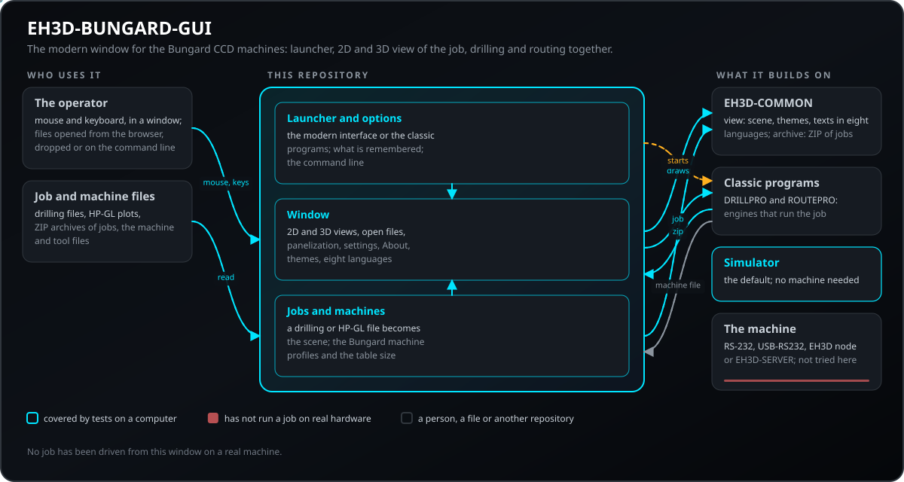
</p>

Cómo encajan las partes de este repositorio: quién lo usa, qué contiene y de qué depende. La imagen se dibuja desde `docs/architecture.json` y se comprueba contra el código.

## 🖼️ Capturas de pantalla

<p align="center">
  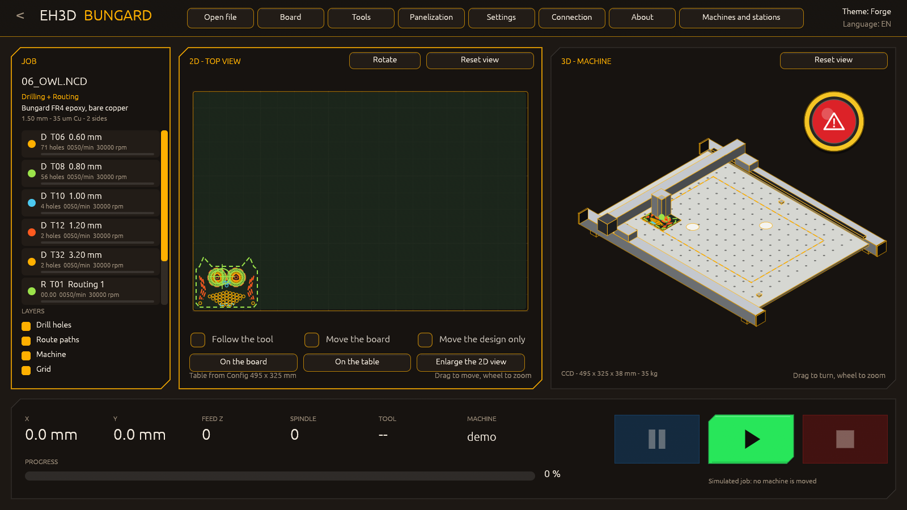
</p>

<p align="center"><em>El visor: el trabajo en la mesa en 2D, la máquina en 3D y los mandos del trabajo.</em></p>

<p align="center">
  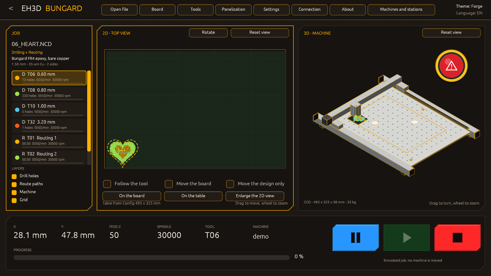
</p>

<p align="center"><em>Un trabajo en marcha: los agujeros y trayectorias hechos, la posición de la herramienta, Pausa y Stop.</em></p>

<p align="center">
  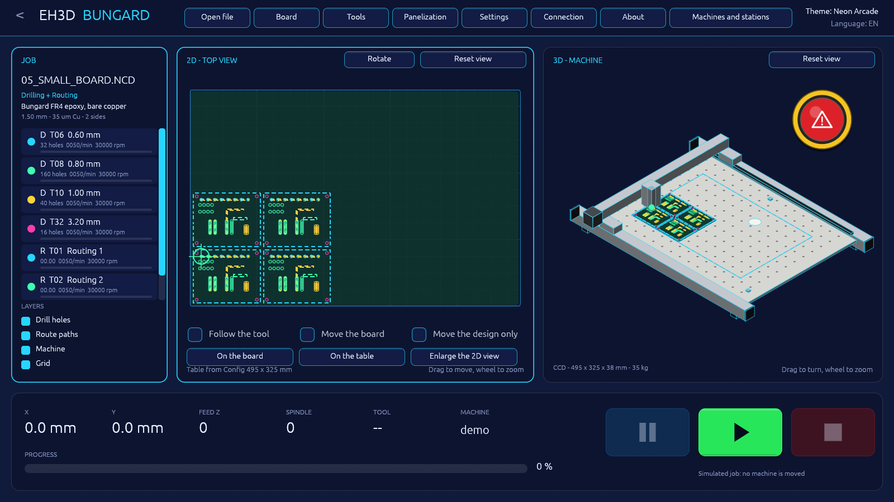
</p>

<p align="center"><em>El tema Neon Arcade con la placa en panel.</em></p>

<p align="center">
  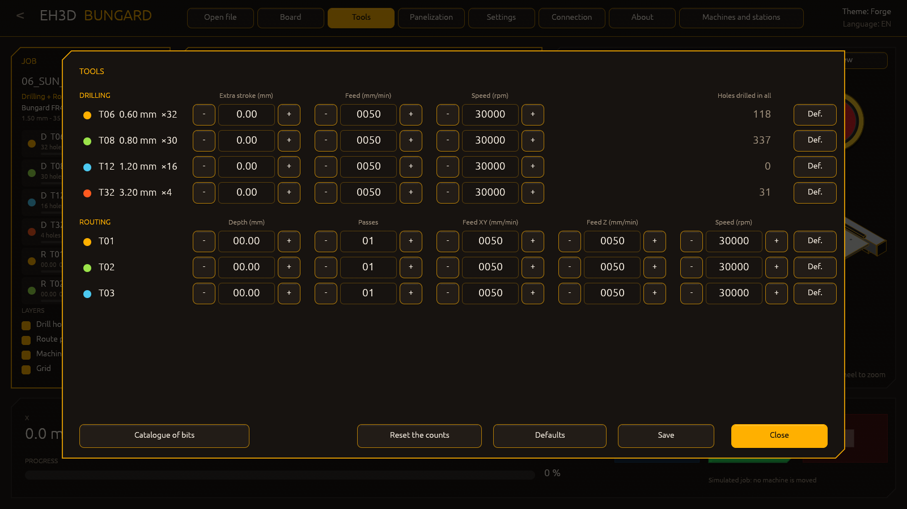
</p>

<p align="center"><em>Las herramientas: avances, velocidades y profundidades, los agujeros de cada broca en la placa y los hechos en total.</em></p>

<p align="center">
  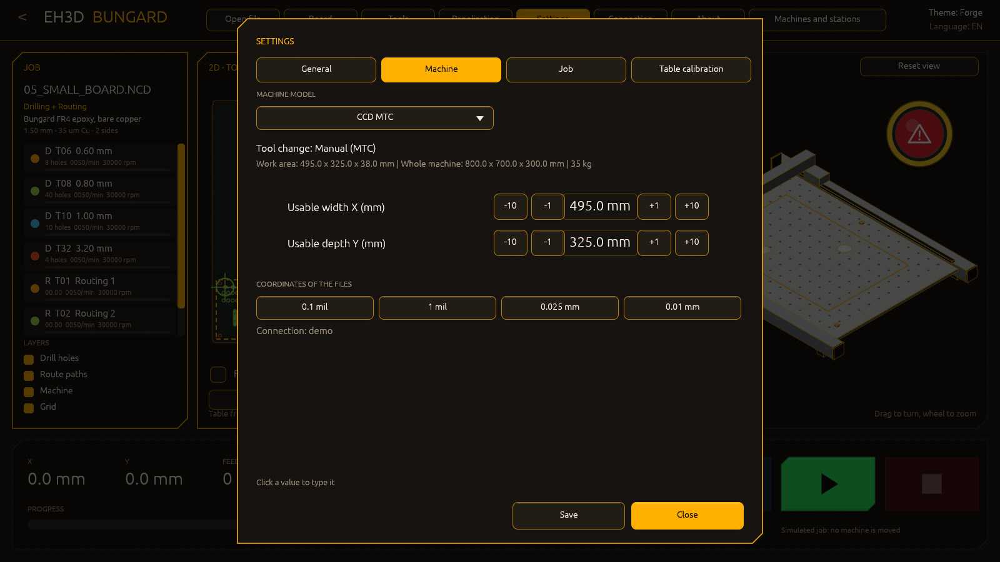
</p>

<p align="center"><em>Los ajustes: cada modelo Bungard, la mesa y las unidades de los ficheros.</em></p>

<p align="center">
  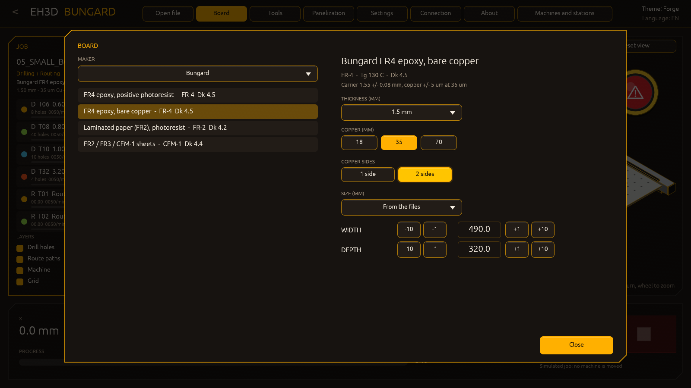
</p>

<p align="center"><em>La placa: un material de la biblioteca, su grosor, su cobre y su tamaño.</em></p>

<p align="center">
  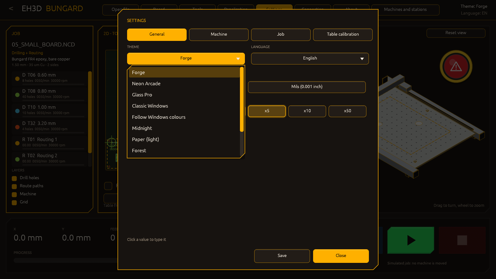
</p>

<p align="center"><em>Once temas en la ventana de ajustes, cada uno con su nombre en el idioma de la ventana.</em></p>

<p align="center">
  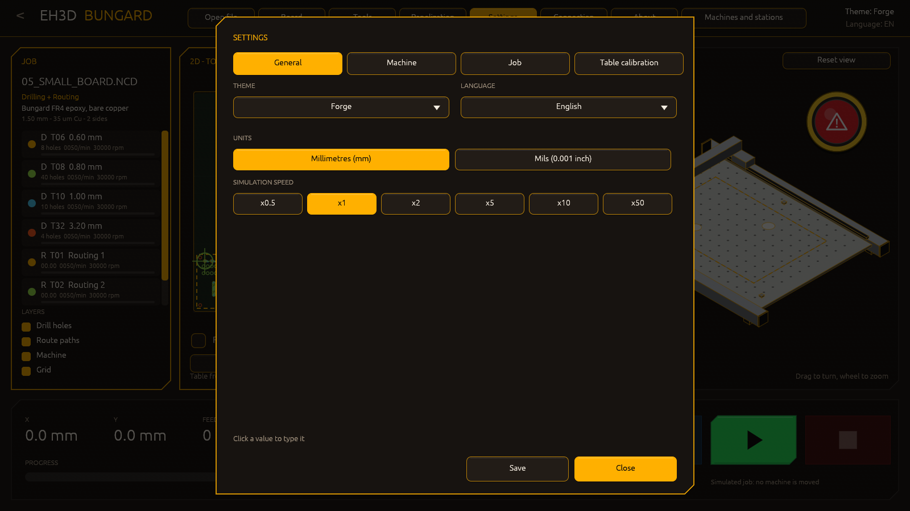
</p>

<p align="center"><em>La lista de sonidos del final del trabajo: sesenta sonidos de los agudos a los graves, el tono estándar, ninguno o un fichero propio.</em></p>

<p align="center">
  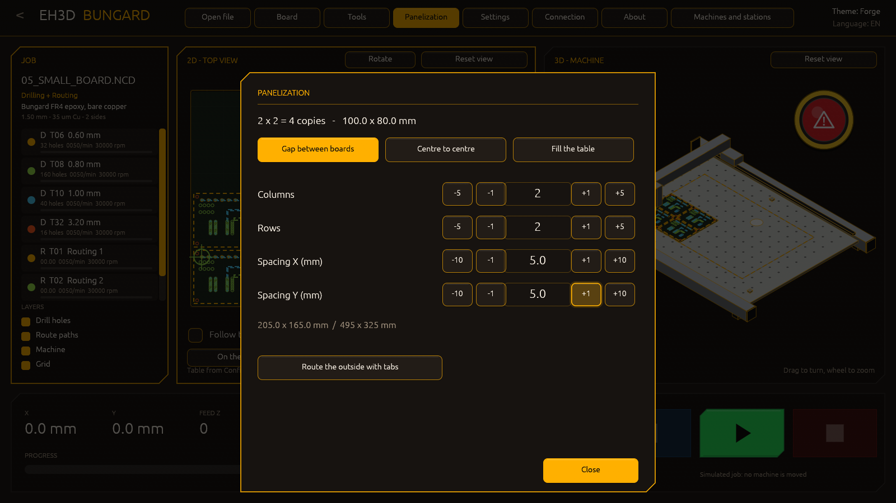
</p>

<p align="center"><em>La ventana de Panelización: las copias de la placa y las muescas del exterior, elegidas con listas desplegables y contadores.</em></p>

<p align="center">
  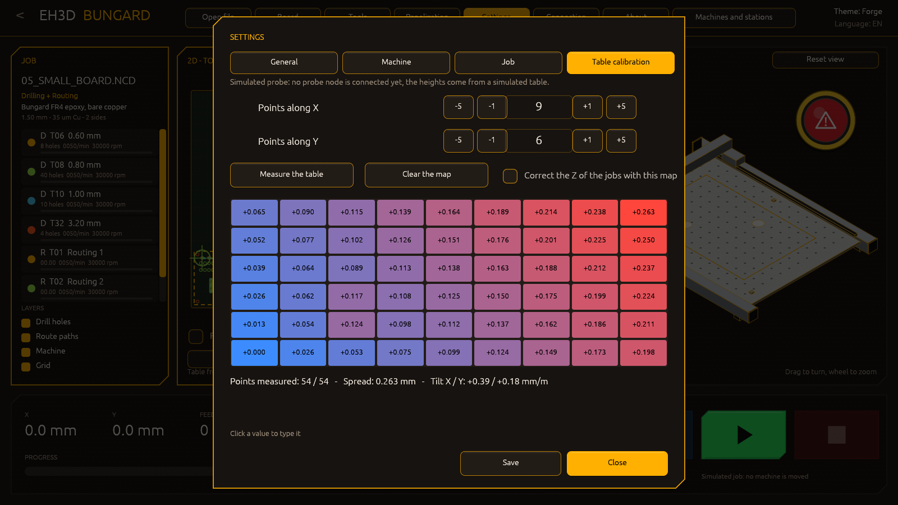
</p>

<p align="center"><em>La calibración de la mesa: el mapa de alturas medido en una malla de puntos, con la diferencia y la inclinación.</em></p>

<p align="center">
  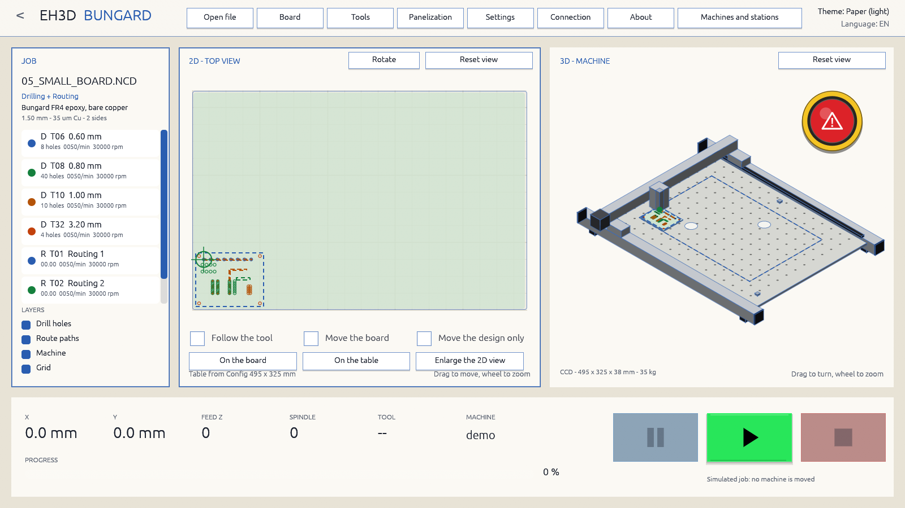
</p>

<p align="center"><em>El tema Papel, uno claro.</em></p>

<p align="center">
  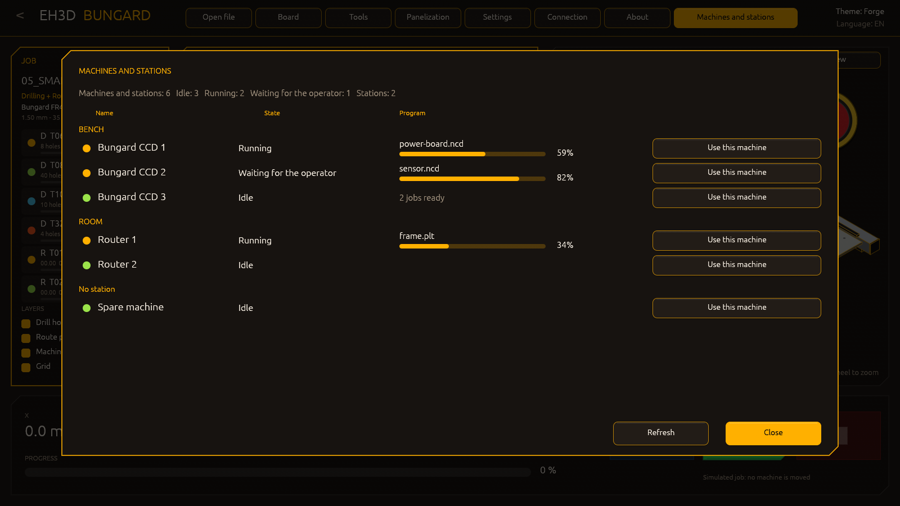
</p>

<p align="center"><em>Las máquinas y estaciones del servidor: estado, trabajo y progreso de cada máquina, y la máquina a la que van los trabajos.</em></p>

## ✨ Funciones

* Temas: Forge (el predeterminado), Neon Arcade, Glass Pro, el gris clásico de Windows y uno que sigue los colores de Windows.
* Ocho idiomas en toda la ventana: inglés, español, francés, italiano, alemán, chino, japonés y portugués de Portugal.
* Perfiles de máquina con las medidas publicadas y una mesa ajustable: la máquina en 3D crece con el área útil de la configuración.
* Una ventana de máquinas y estaciones: con la conexión al servidor muestra todas las máquinas del servidor agrupadas por estación, lo que hace cada una, su trabajo con el progreso, los trabajos listos, y elige la máquina a la que van los trabajos de la ventana; `--fleet FICHERO.json` muestra una respuesta guardada sin servidor.
* Al elegir un modelo de máquina en los ajustes, las dos vistas se ajustan a su mesa: el plano 2D, la máquina 3D (bastidor, carriles, puente y almacén de herramientas de ese modelo) y el zoom empiezan de nuevo con las medidas nuevas.
* Trabajos en archivos ZIP: se muestran el primer fichero de taladrado y el primero de fresado, y los demás se listan para cargarlos con un clic.
* Panelización en tres modos (separación, paso, tantas como quepan) con las copias dibujadas en la mesa.
* Progreso del trabajo en vivo y las preguntas de la máquina al operador.
* Una ventana Acerca de con la versión, la licencia y la conexión en uso.
* Ajustes en pestañas con todos los modelos Bungard MTC y ATC (mesa, cambiador de herramientas, límites) y las unidades de pasos y coordenadas (mm o mil), todo con efecto real en el trabajo.
* Un botón de emergencia que se puede mostrar, ocultar y arrastrar; Start se apaga mientras el trabajo corre y vuelve con Pausa o Stop; la simulación sigue en segundo plano.
* Una vista 2D que sigue cada herramienta, gira juntos los ficheros de taladrado y fresado y mueve la placa; una biblioteca de más de cien materiales base; sonidos al terminar el trabajo y en el cambio de herramienta.
* Ficheros de otros programas: el contorno de una placa Gerber (`.GKO`, `.GM1`, `.GML` o un `.GBR` que se declara perfil) y un dibujo DXF se abren como trabajos de fresado; los círculos y arcos de los ficheros de trazado (`CI`, `AA`, `AR`) se cortan en cuerdas según el ángulo de cuerda de la configuración.
* Un trabajo que no cabe en la mesa se rechaza antes de empezar; la ventana Abrir lista los últimos ficheros abiertos; la ventana de herramientas cuenta los agujeros de cada broca en la placa y en todos los trabajos, con un botón que pone los contadores a cero.
* La ventana de herramientas se abre sobre un fichero que abres (desde la ventana Abrir, los recientes o soltándolo), como los programas clásicos muestran las herramientas de un fichero tras cargarlo; una casilla de los ajustes lo desactiva.
* Listas desplegables donde una elección tiene muchos valores: el tema, el idioma, el modelo de la máquina y el sonido de cada evento se eligen en una lista que se desplaza, en lugar de filas de botones. El final del trabajo y la petición de herramienta tienen cada uno su lista de 60 sonidos, de los agudos a los graves (carillones, notas que suben y bajan, fanfarrias, pitidos, alarmas, golpes, sirenas), el tono estándar, ninguno o un fichero propio; al elegir uno suena.

## 🔌 Interfaces

* **Ventana:** el lanzador y el visor, con el ratón y el teclado (`Enter` acepta la elección del lanzador, `Esc` vuelve atrás, `Ctrl+O` abre ficheros).
* **Línea de órdenes:** `bungard-gui [FICHERO...] [--drill FICHERO.NCD] [--route FICHERO.PLT] [--zip TRABAJO.ZIP] [--lang CÓDIGO] [--theme NOMBRE] [--data DIR] [--connection FICHERO] [--screen launcher|viewer]`; los ficheros sin opción se abren como dice su extensión. `--modal`, `--panel`, `--yaw`, `--shot` y `--start` fijan una ventana, el panel, el giro de la vista 3D, una imagen de la ventana y el inicio del trabajo, para las imágenes.
* **Máquina:** a través de los motores de EH3D-DRILLPRO y EH3D-ROUTEPRO y el fichero de máquina que comparten: el RS-232 del ordenador, un adaptador USB-RS232, el EH3D-NODE-BUNGARD o EH3D-SERVER. Sin fichero de máquina el trabajo se ejecuta en el simulador.

## ⚙️ Configuración

La conexión es el **fichero de la máquina** de EH3D-DRILLPRO y EH3D-ROUTEPRO (`machine.cfg`, con `connection = demo|rs232|usb|node|server` y cada valor afinado en una máquina real): `--connection FICHERO` apunta a él, y sin uno el trabajo se ejecuta en el simulador. `--data DIR` es la carpeta con los ficheros de máquina y herramientas de los programas clásicos (`DRILLPRO.DCF`, `DRILLPRO.DTD`, `ROUTEPRO.RCF`, `ROUTEPRO.RTD`; la carpeta `testdata/` tiene muestras). La ventana de ajustes cambia el ancho y el fondo útiles de la mesa y los guarda en esos ficheros. Lo que la ventana recuerda (la elección del lanzador, el idioma y el tema) se guarda en un pequeño fichero en la carpeta de ajustes del usuario, con los demás programas de EH3D. `--theme forge|neon|glass|windows-classic|system` y `--lang en|es|it|de|fr|pt|zh|ja` eligen el aspecto y el idioma.

## 🚀 Inicio rápido

```bash
cargo build --release --features gui
cargo test --features gui
cargo clippy --all-targets --features gui -- -D warnings
cargo fmt --all --check
python -I tools/ci_validate.py
```

Ejecútalo con `run.bat` (Windows) o `./run.sh` (Linux y macOS); ambos compilan la ventana primero si hace falta y, sin argumentos, abren el lanzador con la placa de prueba de `testdata/`. Necesitan Rust y las carpetas hermanas `EH3D-COMMON`, `EH3D-DRILLPRO` y `EH3D-ROUTEPRO`. `cargo run --release --features gui -- --zip TRABAJO.ZIP` abre un trabajo empaquetado en un archivo ZIP. En Linux la ventana necesita X11 o Wayland.

## 🧪 Pruebas

La suite tiene 75 pruebas (`cargo test --features gui`). Comprueban el lanzador y lo que recuerda, los ajustes, cómo un fichero de taladrado o HP-GL se convierte en la escena, los perfiles de máquina, el panel y la línea de órdenes. Los motores que usa (protocolo, movimiento, puerta de seguridad) se prueban en EH3D-DRILLPRO y EH3D-ROUTEPRO. La CI también ejecuta `cargo fmt --check` y `cargo clippy` con los avisos como errores, y `python -I tools/ci_validate.py` comprueba el manifiesto, las versiones, el registro de cambios y los ocho README.

## 🏗️ Compilación y publicación

La versión vive en `Cargo.toml` y en `eh3d.project.json`, y cada versión tiene su entrada en [CHANGELOG.md](CHANGELOG.md). `build.bat` / `build.sh` compilan la ventana (`cargo build --release --features gui`) y `test.bat` / `test.sh` ejecutan las pruebas; ninguno cambia la versión.

**Paquetes ya compilados:** el flujo `Release binaries` de este repositorio compila el programa para Windows (64 y 32 bits), Linux y macOS (Apple silicon e Intel), cada paquete con la licencia, este README y los ficheros de prueba como ejemplos, y su SHA-256. Todavía no se ha publicado ninguna versión.

## 📂 Estructura del repositorio

<p align="center">
  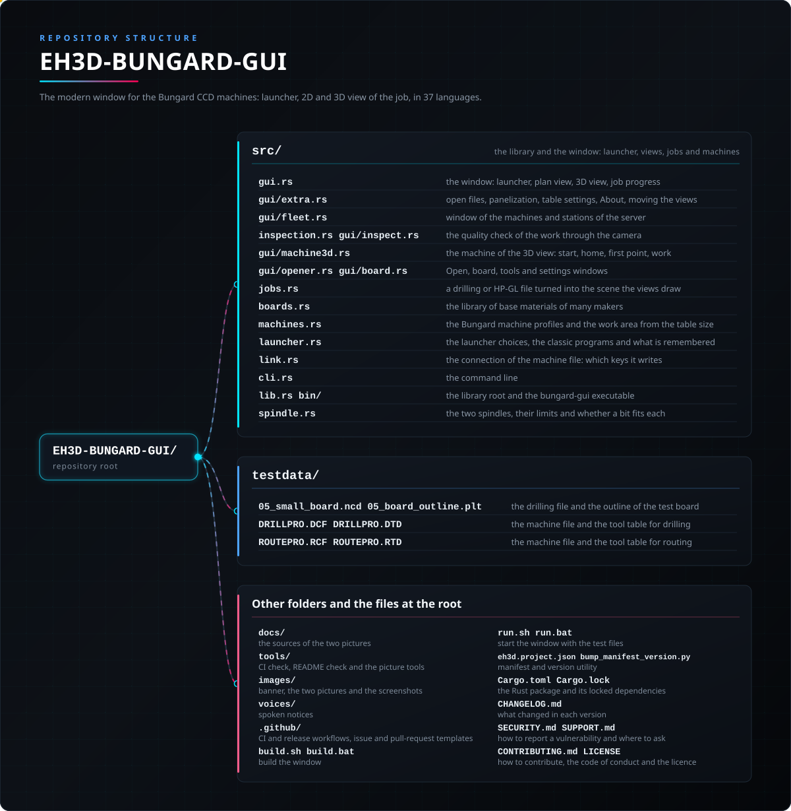
</p>

<details>
<summary>Versión en texto del árbol</summary>

```text
EH3D-BUNGARD-GUI/
├── src/
│   ├── gui.rs                                   la ventana: lanzador, vista en planta, vista 3D, progreso del trabajo
│   ├── gui/extra.rs                             abrir ficheros, panelización, ajustes de la mesa, Acerca de, mover las vistas
│   ├── gui/fleet.rs                             ventana de máquinas y estaciones del servidor
│   ├── gui/opener.rs  gui/board.rs              ventanas Abrir, placa, herramientas y ajustes
│   ├── jobs.rs                                  un fichero de taladrado o HP-GL convertido en la escena que dibujan las vistas
│   ├── boards.rs                                la biblioteca de materiales base de muchos fabricantes
│   ├── machines.rs                              los perfiles de las máquinas Bungard y el área de trabajo según la mesa
│   ├── launcher.rs                              las opciones del lanzador, los programas clásicos y lo que se recuerda
│   ├── link.rs                                  la conexión del fichero de máquina: qué claves escribe
│   ├── cli.rs                                   la línea de órdenes
│   └── lib.rs bin/                              la raíz de la biblioteca y el ejecutable bungard-gui
├── testdata/                                    una placa pequeña: ficheros de taladrado y contorno, y los ficheros de muestra de máquina y herramientas
├── docs/                                        las fuentes de las dos imágenes
├── tools/                                       comprobación de CI, comprobación del README y herramientas de las imágenes
├── images/                                      banner, las dos imágenes y las capturas de pantalla
├── voices/                                      avisos hablados
├── .github/                                     flujos de CI y de publicación, plantillas de issues y pull requests
├── build.sh build.bat                           compilan la ventana
├── run.sh run.bat                               arrancan la ventana, con los ficheros de prueba si no se dan argumentos
├── eh3d.project.json bump_manifest_version.py   manifiesto y utilidad de versión
├── Cargo.toml Cargo.lock                        el paquete de Rust y sus dependencias fijadas
├── CHANGELOG.md                                 qué cambió en cada versión
├── SECURITY.md SUPPORT.md                       cómo informar de una vulnerabilidad y dónde preguntar
└── CONTRIBUTING.md CODE_OF_CONDUCT.md LICENSE   cómo contribuir, el código de conducta y la licencia
```

</details>

## 🗺️ Hoja de ruta y límites conocidos

**Límites conocidos hoy**

* Ningún trabajo se ha manejado desde esta ventana en una máquina real: solo ha corrido en el simulador de los motores de EH3D-DRILLPRO y EH3D-ROUTEPRO.
* La ventana de Conexión escribe en el fichero de la máquina solo las claves del enlace; la de ajustes escribe las claves que ofrece (la mesa, el modelo, las unidades, los sonidos y la velocidad de la simulación) y la de herramientas los avances, las velocidades y las profundidades; el resto de los ficheros de máquina y herramientas no se edita aquí.
* La pausa detiene el trabajo entre dos movimientos, no en mitad de uno, y la vista 3D no muestra la altura de las trayectorias.
* Solo se manejan las máquinas CCD y CCD/2; los perfiles de la CCD Premium y la CCD XL se dibujan, pero su propia unidad de control no está soportada.
* La ventana necesita las carpetas hermanas EH3D-COMMON, EH3D-DRILLPRO y EH3D-ROUTEPRO junto a ella, porque depende de ellas por ruta.

**Siguiente**

* Una pausa en mitad de un movimiento, no solo entre dos movimientos.
* La altura (Z) de las trayectorias en la vista 3D.
* Cargar y guardar toda la configuración, no solo el tamaño de la mesa.
* Empaquetar con los programas clásicos, para que una sola descarga lo tenga todo.
* Una prueba en una máquina real.

## 🌍 Idiomas

El README y los textos existen en inglés, español, francés, italiano, alemán, chino, japonés y portugués de Portugal.

## 🔗 Proyectos relacionados

* [EH3D-DRILLPRO](https://github.com/JuanenRac/EH3D-DRILLPRO): el programa de taladrado; esta ventana usa su motor y su programa clásico
* [EH3D-ROUTEPRO](https://github.com/JuanenRac/EH3D-ROUTEPRO): el programa de fresado; esta ventana usa su motor y su programa clásico
* [EH3D-COMMON](https://github.com/JuanenRac/EH3D-COMMON): la vista (escena, temas, textos en ocho idiomas) y el lector de ZIP que usa esta ventana
* [EH3D-NODE-BUNGARD](https://github.com/JuanenRac/EH3D-NODE-BUNGARD): un nodo ESP32-S3 que va en la caja de la máquina y saca los pasos por su propio puerto serie
* [EH3D-SERVER](https://github.com/JuanenRac/EH3D-SERVER): el centro de la familia EH3D: puede ejecutar el trabajo en la máquina a través de su nodo

## 📚 Documentación

* [Conexión y ajuste](https://github.com/JuanenRac/EH3D-DRILLPRO/blob/main/docs/CONNECTION.md): el fichero de la máquina, las conexiones y cada valor (EH3D-DRILLPRO)
* [Notas del protocolo](https://github.com/JuanenRac/EH3D-DRILLPRO/blob/main/docs/PROTOCOL.md): lo que se sabe de cómo se maneja la unidad de control (EH3D-DRILLPRO)
* [Registro de cambios](CHANGELOG.md)

## 🤝 Contribuir y comunidad

* Antes de una pull request ejecuta `cargo fmt --all --check`, `cargo clippy --all-targets --features gui -- -D warnings`, `cargo test --features gui` y `python -I tools/ci_validate.py`: todo debe pasar. Consulta [CONTRIBUTING.md](CONTRIBUTING.md) y el [código de conducta](CODE_OF_CONDUCT.md).
* El README existe en ocho idiomas: un cambio en el texto se hace en los ocho archivos, y las dos imágenes se dibujan a partir de `docs/architecture.json` y `docs/structure.json` con `tools/make_architecture.py` y `tools/make_structure.py`.
* No describas como funcionando en una máquina lo que solo se ha probado en el simulador.
* Informa de una vulnerabilidad en privado: [SECURITY.md](SECURITY.md). Preguntas, ideas e informes: electrohobby3d@gmail.com ([SUPPORT.md](SUPPORT.md)).

## 👤 AUTOR

**JuanenRac (Electro Hobby 3D)** · electrohobby3d@gmail.com

## 📜 LICENCIA

Software: GPL-3.0-or-later. Véase [LICENSE](LICENSE). Los diseños de hardware de la suite usan CERN OHL-S.
